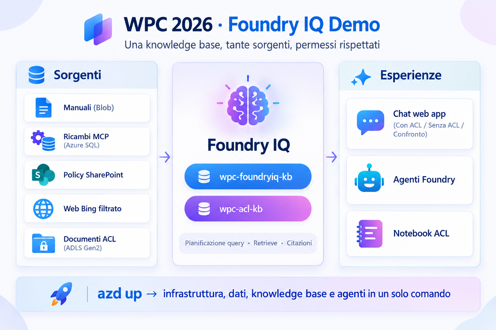
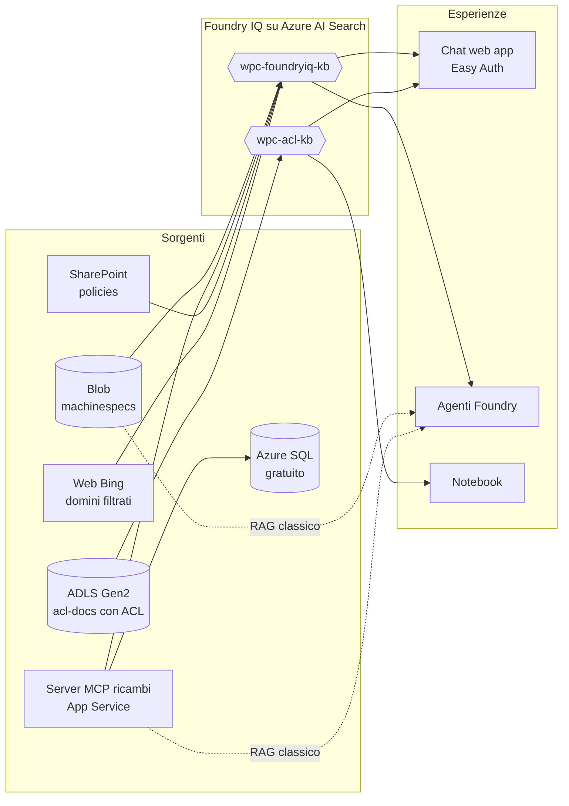
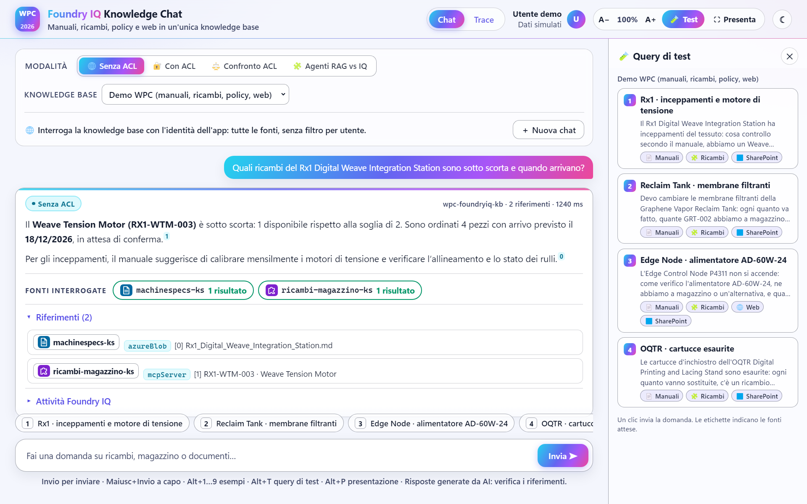
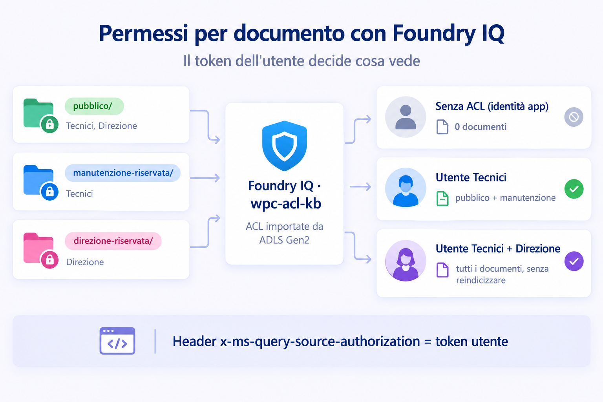

# Demo Foundry IQ · WPC 2026

[](https://elisapiccin.github.io/wpc-foundryiq-demo/)
[](LICENSE)

> **Nota:** progetto dimostrativo, non pronto per la produzione. Manuali, ricambi, policy e documenti ACL sono sintetici; gli account del tenant sono reali. Le risorse Azure e l'eventuale Retrieval API pay-as-you-go possono generare costi: eliminale al termine ([pulizia](#pulizia)).



Un tecnico di manutenzione chiede: *"Il Rx1 ha inceppamenti: quale ricambio serve, è disponibile e cosa dice la policy?"*. Per rispondere servono manuali tecnici, magazzino ricambi, policy aziendali e fornitori sul web. Questa demo usa **Foundry IQ** per riunire le sorgenti disponibili in **una sola knowledge base**; le modalità con ACL inoltrano anche l'identità dell'utente per filtrare i documenti.

## Cosa mostra la demo

| Messaggio | Dove vederlo |
|---|---|
| **Una knowledge base, molte sorgenti**: Blob, server MCP, SharePoint e web Bing filtrato dietro un unico endpoint. | Chat web app, agente `wpc-technician-assistant` |
| **Dati via MCP**: il magazzino non viene indicizzato; Foundry IQ interroga il server MCP al momento della domanda, con eventuale cache SQL lato server. | [mcp-ricambi](mcp-ricambi/README.md) |
| **Permessi per documento**: con il token dell'utente Foundry IQ restituisce solo i documenti che può leggere. | Chat web app (con/senza ACL), notebook [acl-demo.ipynb](acl-demo.ipynb) |
| **RAG classico vs Foundry IQ**: confronta agenti con tool indipendenti e configurazioni diverse con un agente che usa la knowledge base. | Modalità *Agenti RAG vs IQ* della chat |
| **Tutto come codice**: infrastruttura, dati, knowledge source, knowledge base e agenti sono configurati tramite Bicep e script. | [infra](infra/README.md), [agents](agents/README.md) |

## Architettura



| Componente | Descrizione |
|---|---|
| [infra](infra/README.md) | Bicep modulare e hook azd che creano risorse, dati, knowledge source, knowledge base e agenti. |
| [mcp-ricambi](mcp-ricambi/README.md) | Server MCP HTTP in sola lettura per ricambi e magazzino, usato come knowledge source. |
| [agents](agents/README.md) | Agenti Foundry dichiarati in YAML: Foundry IQ, MCP diretto e due agenti RAG classico. |
| [webapp-chat](webapp-chat/README.md) | Chat web con modalità con/senza ACL, confronto affiancato, agenti RAG vs IQ e visualizzatore trace. |
| [data](data/) | Documenti sintetici: manuali, policy SharePoint e documenti con ACL. |
| [scripts](scripts/) | Hook azd e script di setup, eseguibili anche senza azd. |

## Avvio rapido

Prerequisiti: [Azure Developer CLI](https://aka.ms/azd-install), [Azure CLI](https://aka.ms/azcli), PowerShell 7 e Python 3.10 o successivo; una sottoscrizione con quota per i modelli e i permessi per assegnare ruoli. L'elenco completo è nel [README dell'infrastruttura](infra/README.md#prerequisiti).

Dalla root del repository:

```powershell
azd auth login --tenant-id <tenant-id>
az login --tenant <tenant-id>
azd env new wpc-foundryiq
azd up
```


`azd up` crea le risorse Azure, carica i dati, pubblica server MCP e chat web app, poi crea knowledge source, knowledge base, connessioni e agenti Foundry. SharePoint, la demo ACL e il login della chat possono terminare con un avviso: controlla il riepilogo e, se necessario, riprendi i passaggi indicati nella [guida al deployment](infra/README.md#ripresa-dopo-un-errore). Al termine:

```powershell
azd env get-value CHAT_APP_URL      # chat web app
azd env get-value MCP_SERVER_URL    # endpoint MCP
```

### Opzioni di deployment

| Opzione | Come |
|---|---|
| **A. azd** (consigliata) | `azd up`: Bicep e hook pre/post automatici. |
| **B1. Script + Bicep + script** | Senza azd: [deploy_noazd.ps1](scripts/deploy_noazd.ps1) esegue le stesse fasi con Azure CLI, gli stessi moduli Bicep e gli stessi script degli hook. |
| **B2. Creazione manuale** | Oggetti creati dai portali Azure e Foundry, usando i moduli Bicep come specifica. |

Comandi e checklist sono nel [README dell'infrastruttura](infra/README.md#deployment) ([opzione B1](infra/README.md#opzione-b1-script-bicep-e-script-senza-azd)). Se una fase non va a buon fine, con o senza azd, la tabella [Ripresa dopo un errore](infra/README.md#ripresa-dopo-un-errore) indica da dove ripartire senza ripetere le fasi già completate.

## Dati della demo

Gli hook caricano i dati automaticamente:

| Sorgente locale | Destinazione | Knowledge source |
|---|---|---|
| [data/machinespecs](data/machinespecs/) | Container Blob `machinespecs` | `machinespecs-ks` (indicizzata) |
| [mcp-ricambi/data/inventory.json](mcp-ricambi/data/inventory.json) | Database Azure SQL `ricambi` | `ricambi-magazzino-ks` (MCP, live) |
| [data/sharepoint/policies](data/sharepoint/policies/) | Cartella `policies` del sito SharePoint `wpc-foundryiq-demo`, creato se non esiste | `policies-sharepoint-ks` (remota, live) |
| [data/acl](data/acl/) | Container ADLS Gen2 `acl-docs` con ACL per cartella | `acl-docs-ks` |

SharePoint è opzionale: richiede Microsoft 365 nello stesso tenant di Azure e un accesso interattivo a Microsoft Graph. Se non è disponibile, l'hook mostra un avviso e la knowledge base viene creata senza questa sorgente (per saltarla: `azd env set SKIP_SHAREPOINT_SETUP true`). Prerequisiti e licenze sono nella [guida SharePoint](data/sharepoint/foundry-iq-sharepoint-remote-knowledge-source.md).

## Scenari di demo

### 1. Chat web app

[webapp-chat](webapp-chat/README.md) è protetta da login Microsoft Entra e interroga `wpc-foundryiq-kb` e `wpc-acl-kb` in quattro modalità:

- **Con ACL**: il token dell'utente viene inoltrato a Foundry IQ, che filtra i documenti.
- **Senza ACL**: solo l'identità della web app.
- **Confronto affiancato**: le due chiamate in parallelo.
- **Agenti RAG vs IQ**: la stessa domanda a due agenti RAG classici e all'agente Foundry IQ.

La pagina **Trace** rende leggibili messaggi e citazioni degli agenti Foundry.

[](docs/images/chat-fonti.png)

*Clic sull'immagine per ingrandirla. Interfaccia reale con risposte e dati simulati; nessuna interrogazione Azure durante la cattura. La [guida della chat](webapp-chat/README.md) mostra anche confronto ACL e trace.*

### 2. Demo ACL



Se il setup ACL riesce, `azd up` crea due gruppi Entra (*Tecnici*, *Direzione*), carica [data/acl](data/acl/) con ACL per cartella e crea `wpc-acl-kb`. Il notebook [acl-demo.ipynb](acl-demo.ipynb) mostra come cambiano i risultati senza identità utente, con il token dell'utente e dopo un cambio di gruppo, senza reindicizzare. Dettagli nel [README dell'infrastruttura](infra/README.md#demo-acl-permessi-per-documento).

### 3. Agenti Foundry

Gli agenti in [agents](agents/README.md) sono creati dal `postdeploy` di `azd up`, con la knowledge base o il server MCP già collegati, e si possono provare nel playground del portale Foundry.

Il notebook [new-agent-deployment.ipynb](new-agent-deployment.ipynb) mostra invece come creare un Prompt Agent con l'SDK:

1. Apri il notebook in VS Code (estensioni **Python** e **Jupyter**) e seleziona il kernel `.venv`, creato dall'hook `postprovision`.
2. Compila `SUBSCRIPTION_ID` e `RESOURCE_GROUP_NAME` e verifica `BICEP_DEPLOYMENT_NAME`: il `postprovision` stampa i valori da usare. Con `LOAD_BICEP_OUTPUTS = True` il notebook legge il resto dagli output ARM; i valori espliciti hanno precedenza.
3. Esegui le celle nell'ordine.

Il notebook usa `AzureCliCredential`: serve il ruolo **Foundry User** sul progetto. Ogni esecuzione crea una nuova versione dell'agente, senza tool: collega la knowledge base `wpc-foundryiq-kb` dal portale Foundry (**Knowledge > Foundry IQ**).

Per ricreare l'ambiente Python a mano:

```powershell
python -m venv .venv
.\.venv\Scripts\python.exe -m pip install -r .\requirements.txt
```

## Pulizia

```powershell
azd down --purge   # elimina tutte le risorse, Foundry e Search inclusi
```

I gruppi Entra della demo ACL, le app registration della chat e il sito SharePoint non sono risorse Azure: eliminali dai rispettivi portali se non servono più.

## Contribuire

Le regole (solo dati sintetici, nessun segreto, notebook senza output) sono in [CONTRIBUTING.md](CONTRIBUTING.md); per segnalare vulnerabilità segui [SECURITY.md](SECURITY.md).

La documentazione è pubblicata su GitHub Pages: <https://elisapiccin.github.io/wpc-foundryiq-demo/>. Il sito è generato dai README con [MkDocs Material](https://squidfunk.github.io/mkdocs-material/) e pubblicato dal workflow [docs.yml](.github/workflows/docs.yml) a ogni push su `main` che modifica la documentazione. Alla prima attivazione imposta **Settings > Pages > Source** su **GitHub Actions**. Anteprima locale:

```powershell
pip install -r docs/requirements.txt
python scripts/build_docs.py    # copia i README in .site-src/ (ignorata da Git)
python -m mkdocs build --strict # verifica la generazione del sito
python -m mkdocs serve
```

## Licenza

Distribuito con licenza [MIT](LICENSE).
