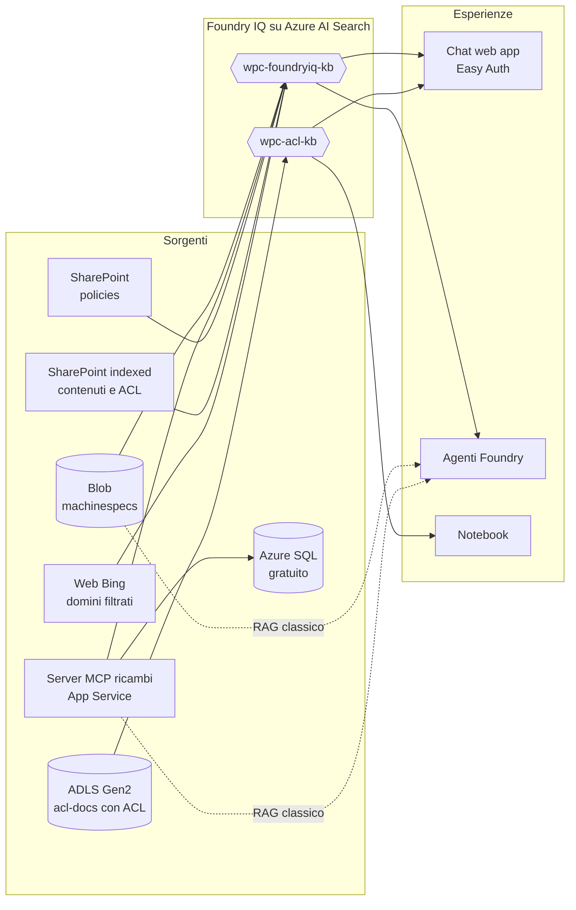
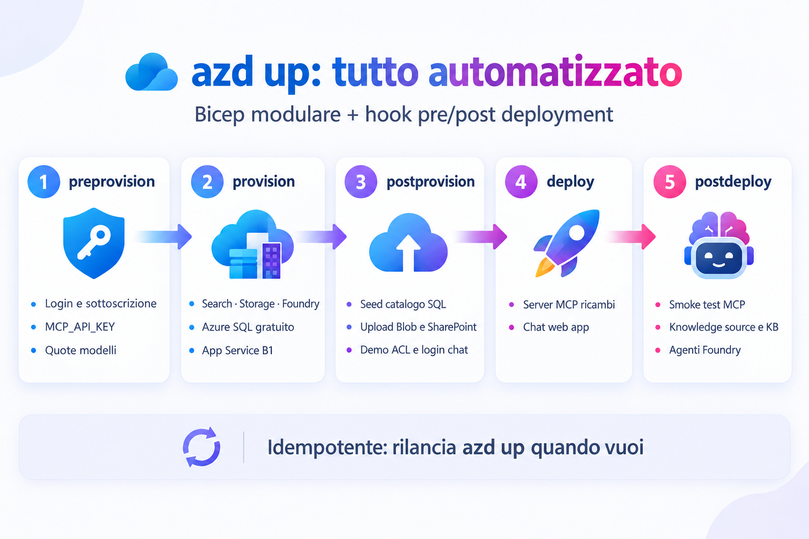
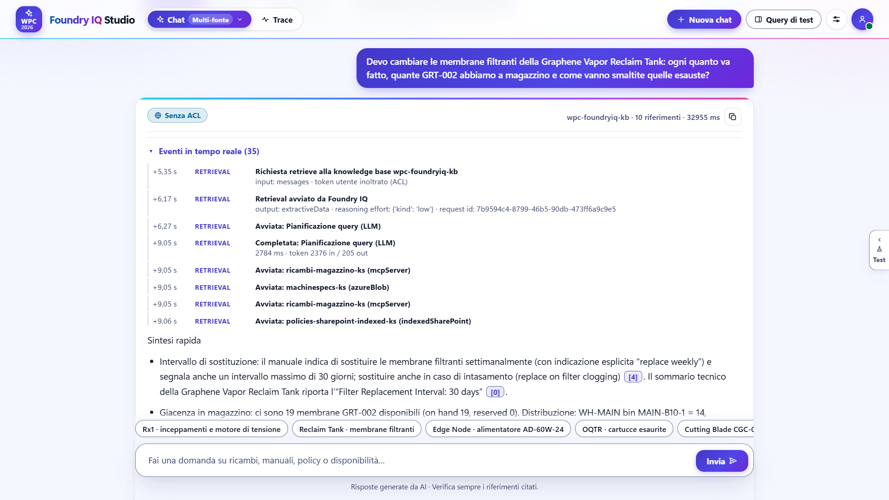

# Demo Foundry IQ · WPC 2026

[](https://congiuluc.github.io/wpc2026-foundryiq-demo/)
[](LICENSE)

> **Nota:** progetto dimostrativo, non pronto per la produzione. Manuali, ricambi, policy e documenti ACL sono sintetici; gli account del tenant sono reali. Le risorse Azure e l'eventuale Retrieval API pay-as-you-go possono generare costi: eliminale al termine ([pulizia](#pulizia)).


Un tecnico di manutenzione chiede: *"Il Rx1 ha inceppamenti: quale ricambio serve, è disponibile e cosa dice la policy?"*. Per rispondere servono manuali tecnici, magazzino ricambi, policy aziendali e fornitori sul web. Questa demo usa **Foundry IQ** per riunire le sorgenti disponibili in **una sola knowledge base**; le modalità con ACL inoltrano anche l'identità dell'utente per filtrare i documenti.

**Per la presentazione:** [copione delle tre demo e video offline](docs/demo-guide.md). I file MP4 in [docs/videos](docs/videos/) si possono riprodurre senza connettività dopo averli scaricati. Le registrazioni interrogano servizi Azure reali con i dati sintetici della demo; non sono risposte simulate.

**Demo via HTTP:** i [file `.http` per VS Code REST Client](http/README.md) mostrano retrieval multi-fonte, confronto ACL e agenti RAG vs Foundry IQ direttamente sulle API, senza avviare notebook o web app.

La web app supporta [risposte e attività in streaming](webapp-chat/README.md#streaming-delle-risposte-e-della-telemetria), anche nei confronti ACL e agenti, con aggiornamento della Trace e consumi retrieval/generazione distinti.

## Cosa mostra la demo

| Messaggio | Dove vederlo |
|---|---|
| **Una knowledge base, molte sorgenti**: Blob, server MCP, SharePoint remoto e/o indicizzato con ACL, web Bing filtrato dietro un unico endpoint. | Route `/demo/multi-fonte` della [chat web app](webapp-chat/README.md), agente `wpc-technician-assistant`, notebook [demo-multi-fonte.ipynb](notebooks/demo/demo-multi-fonte.ipynb) |
| **Dati via MCP**: il magazzino non viene indicizzato; Foundry IQ interroga il server MCP al momento della domanda, con eventuale cache SQL lato server. | [mcp-ricambi](mcp-ricambi/README.md) |
| **Permessi per documento**: con il token dell'utente Foundry IQ restituisce solo i documenti che può leggere. | Route `/demo/acl` della [chat web app](webapp-chat/README.md), notebook [demo-acl.ipynb](notebooks/demo/demo-acl.ipynb) |
| **RAG classico vs Foundry IQ**: confronta agenti con tool indipendenti e configurazioni diverse con un agente che usa la knowledge base, misurando tool, token e tempi. | Route `/demo/agenti` della [chat web app](webapp-chat/README.md), notebook [demo-agenti.ipynb](notebooks/demo/demo-agenti.ipynb) |
| **Trasparenza su identità, flusso e trace**: profilo e gruppi Entra dai claim, infografiche SVG 16:9 e Trace collegata in tempo reale alla chat corrente senza esporre token. | [webapp-chat](webapp-chat/README.md#infografiche-di-architettura-e-query) |
| **Tutto come codice**: infrastruttura, dati, knowledge source, knowledge base e agenti sono configurati tramite Bicep, script o notebook passo-passo. | [infra](infra/README.md), [agents](agents/README.md), [notebooks](notebooks/README.md) |
| **Demo senza rete**: tre registrazioni MP4 con query live, screenshot aggiornati e copione del presentatore. | [Demo live e video offline](docs/demo-guide.md) |

## Architettura



| Componente | Descrizione |
|---|---|
| [infra](infra/README.md) | Bicep modulare e hook azd che creano risorse, dati, knowledge source, knowledge base e agenti. |
| [mcp-ricambi](mcp-ricambi/README.md) | Server MCP HTTP in sola lettura per ricambi e magazzino, usato come knowledge source. |
| [agents](agents/README.md) | Agenti Foundry dichiarati in YAML: Foundry IQ, MCP diretto e due agenti RAG classico. |
| [webapp-chat](webapp-chat/README.md) | **Foundry IQ Knowledge Studio** (FastAPI + React 19 / TypeScript / Vite): route per demo, modalità con/senza ACL, confronto agenti con KPI, profilo Entra, infografiche SVG 16:9 e Trace live. |
| [notebooks](notebooks/README.md) | Notebook Jupyter di deploy (`01` → `02` → `03`) e notebook di demo per ciascun use case (`multi-fonte`, `acl`, `agenti`). |
| [data](data/) | Documenti sintetici: manuali, policy SharePoint e documenti con ACL. |
| [scripts](scripts/) | Hook azd e script di setup, eseguibili anche con Azure CLI. |
| [docs/videos](docs/videos/) | Registrazioni offline MP4 e manifest con data, durata e risultati osservati. |

## Avvio rapido

Prerequisiti: [Azure Developer CLI](https://aka.ms/azd-install), [Azure CLI](https://aka.ms/azcli), PowerShell 7, Python 3.10 o successivo e Node.js con npm per compilare la chat; una sottoscrizione con quota per i modelli e i permessi per assegnare ruoli. L'elenco completo è nel [README dell'infrastruttura](infra/README.md#prerequisiti).

Dalla root del repository:

```powershell
azd auth login --tenant-id <tenant-id>
az login --tenant <tenant-id>
azd env new wpc-foundryiq
azd up
```



`azd up` crea le risorse Azure, carica i dati, pubblica server MCP e chat web app, poi crea knowledge source, knowledge base, connessioni e agenti Foundry. SharePoint, la demo ACL e il login della chat possono terminare con un avviso: controlla il riepilogo e, se necessario, riprendi i passaggi indicati nella [guida al deployment](infra/README.md#ripresa-dopo-un-errore). Al termine:

```powershell
azd env get-value CHAT_APP_URL      # chat web app
azd env get-value MCP_SERVER_URL    # endpoint MCP
```

### Opzioni di deployment

| Opzione | Come |
|---|---|
| **A. azd** (consigliata) | `azd up`: Bicep e hook pre/post automatici. |
| **B1. Script + Bicep + script** | [deploy_noazd.ps1](scripts/deploy_noazd.ps1) esegue le stesse fasi con Azure CLI, gli stessi moduli Bicep e gli stessi script degli hook. |
| **B2. Creazione manuale** | Oggetti creati dai portali Azure e Foundry, usando i moduli Bicep come specifica. |
| **B3. Notebook Jupyter** | Sequenza passo-passo in [notebooks/deploy](notebooks/README.md#sequenza-di-deploy-notebooksdeploy) (`01` → `02` → `03`) con Azure CLI e SDK Python. |

Comandi e checklist sono nel [README dell'infrastruttura](infra/README.md#deployment) ([opzione B1](infra/README.md#opzione-b1-script-bicep-e-script-senza-azd)). Se una fase non va a buon fine, con o senza azd, la tabella [Ripresa dopo un errore](infra/README.md#ripresa-dopo-un-errore) indica da dove ripartire senza ripetere le fasi già completate.

## Dati della demo

Gli hook caricano i dati automaticamente:

| Sorgente locale | Destinazione | Knowledge source |
|---|---|---|
| [data/machinespecs](data/machinespecs/) | Container Blob `machinespecs` | `machinespecs-ks` (indicizzata) |
| [mcp-ricambi/data/inventory.json](mcp-ricambi/data/inventory.json) | Database Azure SQL `ricambi` | `ricambi-magazzino-ks` (MCP, live) |
| [data/sharepoint/policies](data/sharepoint/policies/) | Cartelle `policies/EN` e `policies/IT` del sito SharePoint `wpc-foundry-iq-demo`, creato se non esiste | `policies-sharepoint-ks` (remota, live) e `policies-sharepoint-indexed-ks` (indicizzata con ACL, se configurata la connessione di ingestion); entrambe le lingue |
| [data/acl](data/acl/) | Container ADLS Gen2 `acl-docs` con ACL per cartella | `acl-docs-ks` |

SharePoint è opzionale: richiede Microsoft 365 nello stesso tenant di Azure e un accesso interattivo a Microsoft Graph. Se non è disponibile, l'hook mostra un avviso e la knowledge base viene creata senza questa sorgente (per saltarla: `azd env set SKIP_SHAREPOINT_SETUP true`). Prerequisiti e licenze sono nella [guida SharePoint](data/sharepoint/foundry-iq-sharepoint-remote-knowledge-source.md).

La sorgente **SharePoint indexed** viene aggiunta automaticamente: il postprovision esegue `scripts/setup_sharepoint_indexed.ps1`, che crea un'app di ingestion secretless (credenziale federata con l'identità di Search), concede i permessi applicativi Graph e salva `SHAREPOINT_INDEXED_CONNECTION_STRING`. Il consenso richiede un ruolo di amministratore Entra; in alternativa puoi impostare la connessione a mano o saltare il passo con `SKIP_SHAREPOINT_INDEXED_SETUP=true`. Importa contenuti e ACL in Search, senza usare la Copilot Retrieval API; configurazione e limiti sono in [SharePoint indexed](infra/README.md#sharepoint-indexed).

## Scenari di demo

### 1. Chat web app (Foundry IQ Knowledge Studio)

[webapp-chat](webapp-chat/README.md) è un'applicazione FastAPI + React/TypeScript protetta da login Microsoft Entra. Oltre alla panoramica generale (`/`), espone route dedicate per ciascuna demo (`/demo/multi-fonte`, `/demo/acl`, `/demo/agenti`) e interroga `wpc-foundryiq-kb` e `wpc-acl-kb` in quattro modalità:

- **Senza ACL**: usa solo l'identità gestita della web app (SharePoint remoto applica comunque i permessi dell'utente).
- **Con ACL**: inoltra il token Search dell'utente a Foundry IQ, che filtra i documenti in base ai suoi permessi.
- **Confronto ACL**: esegue le due chiamate in parallelo e mostra le risposte affiancate.
- **Agenti RAG vs IQ**: confronta in parallelo gli agenti RAG classici e l'agente Foundry IQ con KPI su chiamate tool, tempi e token.

Include inoltre la finestra **Identità e sessione utente** (profilo e gruppi Entra dai claim), le **infografiche SVG 16:9** in stile Fluent per architettura e flusso osservato, gli **eventi in tempo reale** in ogni risposta (query, fonti, tool con durata, riferimenti e primo token ricevuti in streaming), i riferimenti SharePoint con file, percorso e punteggio, e una dialog **Trace** aggiornata in tempo reale con tappe, fasi, attività Foundry IQ e argomenti dei tool. Il visualizzatore `/trace` resta disponibile per analizzare trace caricate manualmente.

[](docs/images/chat-fonti.png)

*Clic sull'immagine per ingrandirla. Interfaccia corrente con risposte effettive dei servizi Azure sul corpus sintetico. Acquisizione locale con Azure CLI, non una verifica del login Easy Auth. La [guida della chat](webapp-chat/README.md) mostra anche confronto ACL, confronto agenti, profilo oscurato, infografiche e Trace.*

[](docs/images/chat-timeline.png)

*Eventi in tempo reale della stessa query: pianificazione con token e avvio di ogni knowledge source, con l'istante relativo all'invio.*

### 2. Demo ACL


Se il setup ACL riesce, vengono creati due gruppi Entra (*Tecnici*, *Direzione*), caricati i file di [data/acl](data/acl/) con ACL POSIX per cartella e creata `wpc-acl-kb`. Puoi provarla nella route `/demo/acl` della web app oppure nel notebook [demo-acl.ipynb](notebooks/demo/demo-acl.ipynb), che confronta i risultati senza e con il token sorgente dell'utente corrente verificando appartenenze e ACL reali senza modificare i gruppi. Dettagli nel [README dell'infrastruttura](infra/README.md#demo-acl-permessi-per-documento).

### 3. Agenti Foundry

Gli agenti in [agents](agents/README.md) vengono pubblicati sul progetto Foundry con la knowledge base o il server MCP già collegati. Si possono confrontare nella route `/demo/agenti` della chat web app, nel notebook [demo-agenti.ipynb](notebooks/demo/demo-agenti.ipynb) oppure nel playground del portale Foundry.

[](docs/images/chat-agenti.png)

### Video di riserva

| Demo | Registrazione offline | Guida |
|---|---|---|
| Multi-fonte | [Scarica MP4](docs/videos/demo-multi-fonte.mp4) | [Copione e player](docs/demo-guide.md#demo-1-una-domanda-piu-fonti) |
| Permessi ACL | [Scarica MP4](docs/videos/demo-acl.mp4) | [Copione e player](docs/demo-guide.md#demo-2-permessi-per-documento) |
| RAG vs Foundry IQ | [Scarica MP4](docs/videos/demo-agenti.mp4) | [Copione e player](docs/demo-guide.md#demo-3-agenti-rag-classico-vs-foundry-iq) |

Scaricali prima della sessione: aprire GitHub Pages richiede ancora la rete. Sono registrazioni precedenti, senza audio e con indicazioni in italiano, non prove dei permessi o delle prestazioni attuali. Dettagli in [manifest.json](docs/videos/manifest.json).

### 4. Notebook di deploy e demo

La guida completa è in [notebooks/README.md](notebooks/README.md). I notebook di deploy usano gli output ARM `wpc-foundryiq-<ambiente>`; quelli demo leggono per default l'ambiente azd selezionato e possono invece usare gli output ARM:

Nei tre notebook di deploy puoi impostare `LOAD_AZD_ENV = True` e `AZD_ENVIRONMENT_NAME = ""` nella prima cella per precompilare la configurazione dall'ambiente azd selezionato, oppure indicare un nome esplicito. L'helper [notebook_env.py](scripts/notebook_env.py) carica solo impostazioni non segrete nel kernel; non genera `.env` e non avvia il deploy. I quattro notebook demo/test usano lo stesso helper con `CONFIG_SOURCE = "azd"`; con `"arm"` non chiamano azd.

| Notebook | Cosa fa |
|---|---|
| [deploy/01-infrastruttura](notebooks/deploy/01-infrastruttura.ipynb) | Preflight (utente, quote, chiave MCP), what-if e deployment di subscription di [main.bicep](infra/main.bicep). `RUN_DEPLOY=False` per default. |
| [deploy/02-dati-identita-app](notebooks/deploy/02-dati-identita-app.ipynb) | Seed SQL, manuali su Blob, gruppi Entra e ACL ADLS, autenticazione Entra della chat, build e deploy di MCP e chat, smoke test. |
| [deploy/03-foundry-iq-agenti](notebooks/deploy/03-foundry-iq-agenti.ipynb) | Knowledge source e knowledge base Foundry IQ (multi-fonte, SharePoint opzionale, ACL), connessioni del progetto e agenti da [agents](agents/README.md). |
| [demo/demo-multi-fonte](notebooks/demo/demo-multi-fonte.ipynb) | Scenari multi-fonte: fonti interrogate rispetto a quelle attese, riferimenti e risposta con citazioni. |
| [demo/demo-acl](notebooks/demo/demo-acl.ipynb) | Gruppi e ACL reali, retrieve senza e con il token sorgente dell'utente, senza modificare gruppi. |
| [demo/demo-agenti](notebooks/demo/demo-agenti.ipynb) | Confronto tra agenti RAG classico e Foundry IQ: tool, chiamate, citazioni, token e tempi; agente magazzino MCP. |
| [demo/demo-foundry-iq-sdk](notebooks/demo/demo-foundry-iq-sdk.ipynb) | Query SDK delle KB multi-fonte o ACL con contenuti, riferimenti e attività. |

Per ricreare l'ambiente Python a mano:

```powershell
python -m venv .venv
.\.venv\Scripts\python.exe -m pip install -r .\requirements.txt -r .\notebooks\requirements.txt
```

## Pulizia

```powershell
azd down --purge   # elimina tutte le risorse, Foundry e Search inclusi
```

I gruppi Entra della demo ACL, le app registration della chat e il sito SharePoint non sono risorse Azure: eliminali dai rispettivi portali se non servono più.

## Contribuire

Le regole (solo dati sintetici, nessun segreto, notebook senza output) sono in [CONTRIBUTING.md](CONTRIBUTING.md); per segnalare vulnerabilità segui [SECURITY.md](SECURITY.md).

La documentazione è pubblicata su GitHub Pages: <https://congiuluc.github.io/wpc2026-foundryiq-demo/>. Il sito è generato dai README, dalle guide e dagli asset (immagini e video) con [MkDocs Material](https://squidfunk.github.io/mkdocs-material/) e pubblicato dal workflow [docs.yml](.github/workflows/docs.yml) a ogni push su `main` che modifica la documentazione. Alla prima attivazione imposta **Settings > Pages > Source** su **GitHub Actions**. Le modifiche locali non pubblicano da sole il sito. Anteprima locale:

```powershell
pip install -r docs/requirements.txt
python scripts/build_docs.py    # copia i README in .site-src/ (ignorata da Git)
python -m mkdocs build --strict # verifica la generazione del sito
python -m mkdocs serve
```

## Licenza

Distribuito con licenza [MIT](LICENSE).
