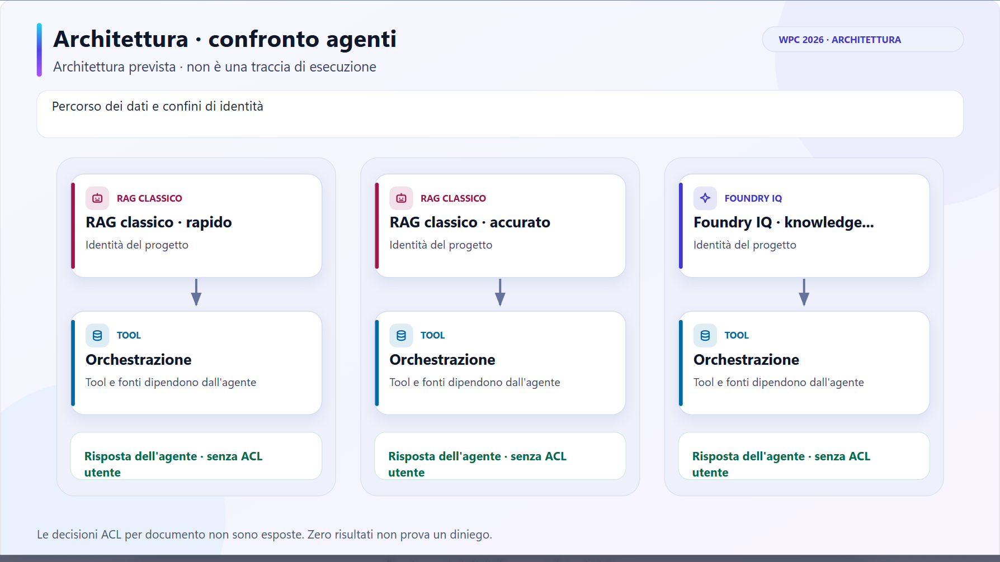
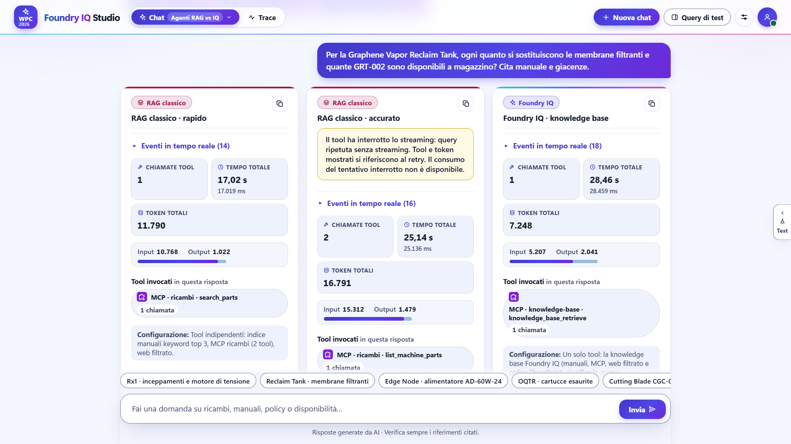
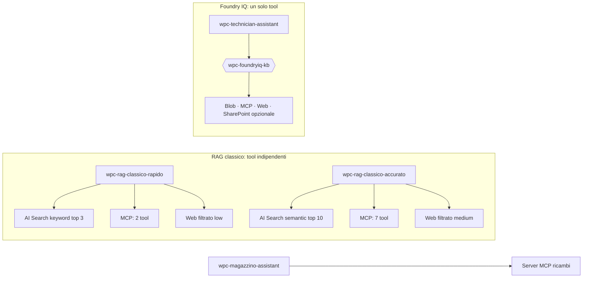

# Agenti Foundry (agents-as-code)



Ogni file `*.yaml` di questa cartella definisce un Prompt Agent Foundry. L'hook `postdeploy` di azd li crea o aggiorna con [setup_foundry_agents.py](../scripts/setup_foundry_agents.py) (oppure tramite il notebook [03-foundry-iq-agenti.ipynb](../notebooks/deploy/03-foundry-iq-agenti.ipynb)), dopo aver creato knowledge base e connessioni. Se la creazione fallisce, `azd deploy` termina con errore: correggi la causa e rilancia `azd hooks run postdeploy` (lo script è idempotente).

| Agente | Tool | Scopo |
|---|---|---|
| `wpc-technician-assistant` | Knowledge base `wpc-foundryiq-kb` (`knowledge_base_retrieve`) | Risposte con citazioni da manuali, ricambi, policy SharePoint e Bing filtrato. |
| `wpc-magazzino-assistant` | Server MCP ricambi (connessione `mcp-ricambi-key`) | Chiamate dirette ai tool del magazzino, da confrontare con il retrieval Foundry IQ. |
| `wpc-rag-classico-rapido` | Azure AI Search (`simple`, top 3), MCP (`search_parts`, `check_stock`), web search (contesto `low`) | RAG "classico", prima di Foundry IQ: l'agente sceglie da solo tra tool indipendenti. |
| `wpc-rag-classico-accurato` | Azure AI Search (`semantic`, top 10), MCP (7 tool), web search (contesto `medium`), prompt con orchestrazione esplicita | Stesse sorgenti del rapido, configurate diversamente. |

Il prompt di `wpc-technician-assistant` richiede query in inglese e risposte nella lingua dell'utente, con citazioni `[ref_id:<valore>]` basate sugli ID non ambigui restituiti dal tool. La modifica al prompt richiede l'aggiornamento dell'agente distribuito. La knowledge base include ancora Bing: il prompt da solo non garantisce l'esclusione delle fonti web esterne.

### Come leggere il confronto

- **Tra i due agenti RAG classici** le categorie di sorgenti sono le stesse (indice dei manuali, server MCP, Bing sugli stessi domini), come il modello. Cambiano però configurazione del retrieval, tool MCP disponibili e prompt: il confronto mostra anche l'effetto di queste scelte.
- **Rispetto a `wpc-technician-assistant`** la knowledge base può includere anche SharePoint, che senza identità utente di solito non restituisce risultati. Foundry IQ pianifica le query, interroga le sorgenti pertinenti e riordina i risultati con un solo tool.
- L'indice è quello creato dalla knowledge source Blob (`FOUNDRYIQ_DEMO_BLOB_INDEX`) e la connessione Search è `FOUNDRYIQ_SEARCH_CONNECTION_ID` (output Bicep).

Il confronto si prova nella route `/demo/agenti` (modalità **Agenti RAG vs IQ**) della [chat web app](../webapp-chat/README.md) oppure nel notebook [demo-agenti.ipynb](../notebooks/demo/demo-agenti.ipynb).

Per la presentazione senza connettività: [video MP4 del confronto](../docs/videos/demo-agenti.mp4) e [copione con prerequisiti e troubleshooting](../docs/demo-guide.md#demo-3-agenti-rag-classico-vs-foundry-iq). Le tre risposte sono acquisite dai servizi reali sul corpus sintetico. I KPI descrivono quella sessione: configurazioni, quota, cache e attività interne della KB possono cambiare, quindi non costituiscono un benchmark.

[](../docs/images/chat-agenti.png)

[](../docs/images/chat-agenti-metriche.png)


## Schema

```yaml
name: nome-agente                 # obbligatorio
description: testo libero
model: ${FOUNDRYIQ_DEMO_CHAT_DEPLOYMENT=gpt-5-mini}   # obbligatorio
instructions: |                   # obbligatorio
  ...
temperature: 0.2                  # opzionale
tools:
  - type: knowledge_base          # knowledge base Foundry IQ via MCP
    server_url: ${FOUNDRYIQ_DEMO_KB_MCP_ENDPOINT}
    connection: ${FOUNDRYIQ_DEMO_KB_CONNECTION}
  - type: mcp                     # server MCP remoto
    server_label: etichetta
    server_url: https://...
    connection: nome-connessione  # opzionale: credenziali nella connessione del progetto
    require_approval: never       # default never
    allowed_tools: [tool1, tool2] # opzionale
  - type: azure_ai_search         # indice Azure AI Search (RAG classico)
    connection: ${FOUNDRYIQ_SEARCH_CONNECTION_ID}  # ID ARM della connessione Search del progetto
    index_name: nome-indice
    query_type: simple            # simple | semantic | vector | vector_simple_hybrid | vector_semantic_hybrid
    top_k: 5                      # opzionale
    filter: "campo eq 'x'"        # opzionale, filtro OData
  - type: web_search              # ricerca web con grounding Bing
    allowed_domains: [a.com, b.com]  # lista o stringa separata da virgola/punto e virgola
    search_context_size: medium   # opzionale: low | medium | high
```

`${VAR}` e `${VAR=default}` sono letti dalle variabili d'ambiente o da `azd env get-values`; una variabile mancante senza default blocca il deploy. Le chiavi non vanno mai scritte nei file: usa una connessione del progetto Foundry.

## Comandi

```powershell
.\.venv\Scripts\python.exe scripts\setup_foundry_agents.py --dry-run   # mostra le definizioni risolte
.\.venv\Scripts\python.exe scripts\setup_foundry_agents.py             # crea/aggiorna gli agenti
```

Ogni versione salva nei metadata `definition_sha256`: se il file non cambia, non viene creata una nuova versione. Per saltare il passo durante `azd deploy` imposta `azd env set SKIP_FOUNDRY_AGENTS_SETUP true`.

Gli agenti usano l'identità gestita del progetto: le ACL per documento della demo ACL non vengono applicate. Per l'enforcement delle ACL usa la route `/demo/acl` della [chat web app](../webapp-chat/README.md) o il notebook [demo-acl.ipynb](../notebooks/demo/demo-acl.ipynb).
