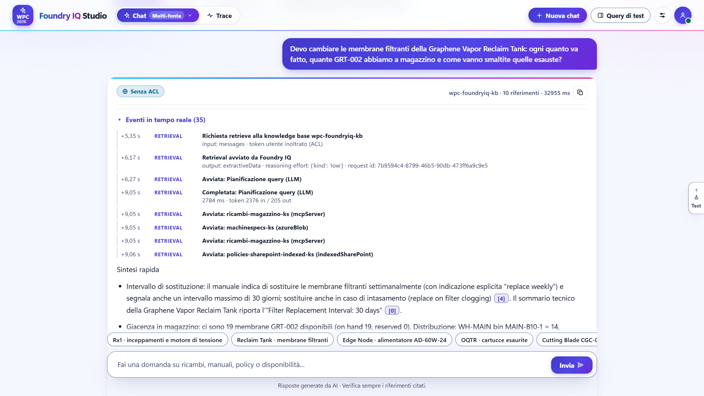
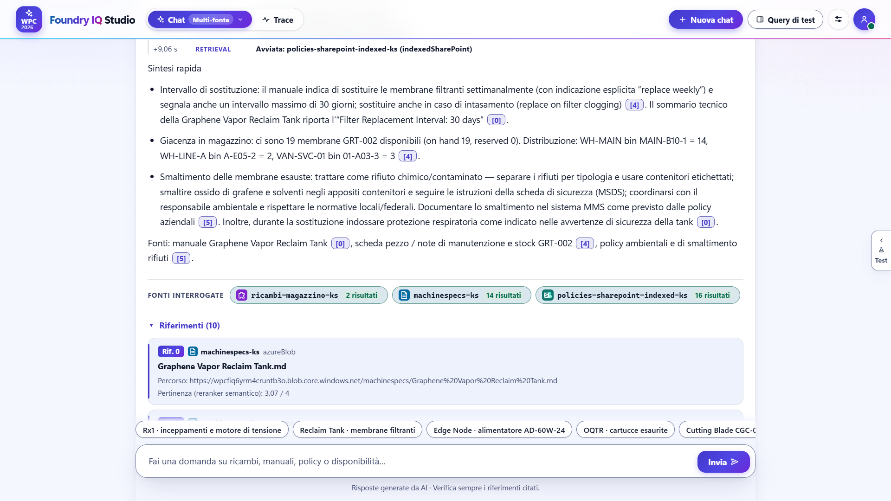
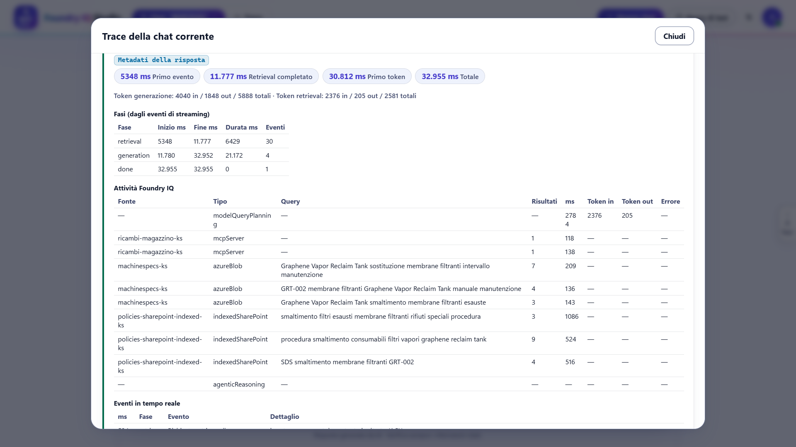

# Demo live e video offline

Tre percorsi dimostrativi della stessa applicazione: **multi-fonte**, **ACL** e **agenti RAG vs Foundry IQ**. Questa guida è il copione per la presentazione e il piano di riserva quando rete, token o servizi non sono disponibili.

I video sono **MP4 H.264, 1920 × 1080, 24 fps, senza audio**, con indicazioni in italiano sovrapposte all'interfaccia. Le risposte provengono dai servizi Azure effettivamente interrogati dalla versione locale corrente della chat, autenticata tramite Azure CLI. Manuali, policy e giacenze restano i **dati sintetici del repository**, non dati di clienti. Non sono risposte mock; identità e ID personali sono oscurati. Le infografiche di architettura descrivono invece il percorso previsto, non una query osservata.

La registrazione locale usa la credenziale Azure del presentatore anche per autorizzare il backend: non dimostra il flusso di login Easy Auth o l'identità gestita dell'app distribuita. Nella demo agenti le chiamate avvengono con il contesto del progetto Foundry. Per verificare l'esperienza distribuita esegui anche la demo sull'URL della Web App.

## Piano di riserva prima della sessione

1. Scarica i tre file MP4 o clona il repository **prima** di entrare in sala.
2. Prova la riproduzione con il lettore locale, non solo con il browser su GitHub Pages.
3. Tieni la cartella `docs\videos` aperta: se la rete cade, avvia il video dello scenario interessato.
4. Presentalo come **registrazione di una sessione precedente**, non come una risposta live o una prova dei permessi attuali.

| Scenario | File da tenere in locale | Cosa mostra |
|---|---|---|
| Multi-fonte | [demo-multi-fonte.mp4](videos/demo-multi-fonte.mp4) | Domanda sulle membrane GRT-002 in streaming, eventi in tempo reale, fonti, riferimenti (anche SharePoint), flusso osservato e Trace con tappe e fasi. |
| ACL | [demo-acl.mp4](videos/demo-acl.mp4) | Stessa domanda con/senza token utente, poi domanda sugli accordi riservati alla Direzione. |
| Agenti | [demo-agenti.mp4](videos/demo-agenti.mp4) | Tre agenti in streaming sulla stessa domanda: eventi, tool con durata, token, tempi e Trace. |

Data di acquisizione, durata e riepilogo delle risposte osservate sono nel [manifest degli asset](videos/manifest.json). Fonti configurate, indicizzazione, permessi e risultati possono cambiare dopo la registrazione; non assumere che tutte le fonti siano state interrogate o abbiano risposto.

### Esiti della registrazione del 22 novembre 2026

| Demo | Durata | Osservazione, non garanzia di un run futuro |
|---|---|---|
| Multi-fonte | 103 s | MCP ricambi, manuali Blob e SharePoint **indexed** interrogati, 10 riferimenti finali, risposta in circa 33 s (retrieval completato a 11,8 s, primo token a 30,8 s). Questa query non dimostra l'uso di SharePoint remoto o Bing. |
| ACL | 86 s | La procedura restituisce un riferimento con token utente e zero senza; la domanda riservata alla Direzione restituisce zero in entrambe le richieste. |
| Agenti | 103 s | Tre risposte riuscite. RAG accurato mostra l'avviso di interruzione dello stream del tool e il retry senza streaming (2 chiamate tool); Foundry IQ espone 8 riferimenti e 2 citazioni, i RAG classici nessuna citazione strutturata in questa sessione. |

I tre MP4 occupano complessivamente circa **7,7 MiB**. Il copione sotto è anche la descrizione testuale del percorso per i video senza audio.

## Demo 1: una domanda, più fonti

**Momento WOW:** una sola domanda combina il manuale della macchina e il magazzino senza chiedere al tecnico di scegliere un tool. La striscia delle fonti distingue ciò che è stato realmente interrogato da ciò che era solo atteso.

**Prerequisiti:** knowledge base multi-fonte, manuali indicizzati, server MCP raggiungibile e deployment di sintesi. Per le policy remote serve anche il token utente e una licenza/PAYG appropriata; [SharePoint indexed](../infra/README.md#sharepoint-indexed) richiede ingestion e ACL valide.

1. Apri `/demo/multi-fonte` dall'URL della chat restituito da `azd env get-value CHAT_APP_URL`, oppure dal server locale già avviato.

   > **Da dire:** "La knowledge base riunisce manuali, magazzino e sorgenti opzionali. L'architettura è la mappa prevista; vedremo poi il percorso effettivo."

2. Apri **Architettura e ACL**, poi **Query di test**. Scegli la domanda *Reclaim Tank · membrane filtranti*.

   > **Da dire:** "Chiedo frequenza di sostituzione, disponibilità delle GRT-002 e smaltimento: tre aspetti che possono richiedere fonti diverse."

3. Invia la domanda e osserva **Eventi in tempo reale** mentre arrivano: pianificazione delle query, avvio e completamento di ogni knowledge source, riferimenti risolti e primo token.

   > **Da dire:** "Lo streaming ci mostra cosa sta facendo Foundry IQ prima ancora della risposta: quali fonti interroga, con quali query e quanto impiega ciascuna."

4. Leggi **Fonti interrogate**, risposta e **Riferimenti**. Per SharePoint il riferimento riporta nome del file, percorso e punteggio del reranker. Apri una citazione solo se il collegamento è presente.

   > **Da dire:** "Questi sono risultati effettivi. Un chip vuoto o in errore resta visibile: non lo sostituiamo con una risposta inventata."

5. Apri l'**Infografica del flusso** dalla risposta e **Trace corrente** dai controlli. Scorri fino a **Metadati della risposta**: tappe (primo evento, retrieval completato, primo token, totale), fasi, attività Foundry IQ per fonte con query e token.

   > **Da dire:** "Qui distinguiamo source osservate, riferimenti e sintesi, con tempi misurati sullo stream. La Trace della chat non è la trace interna completa di Foundry."

<video class="demo-video" controls preload="none" playsinline poster="images/chat-fonti.png" aria-label="Registrazione offline della demo multi-fonte">
  <source src="videos/demo-multi-fonte.mp4" type="video/mp4">
  Il browser non supporta la riproduzione video.
</video>

[Scarica il video multi-fonte](videos/demo-multi-fonte.mp4) · [Screenshot della risposta](images/chat-fonti.png) · [Flusso osservato](images/chat-infografica.png)

[](images/chat-timeline.png)

*Eventi in tempo reale: richiesta retrieve, pianificazione query con token e avvio delle singole knowledge source, con l'istante relativo all'invio.*

[](images/chat-fonti-dettaglio.png)

*Fotogramma del video: fonti e riferimenti effettivamente restituiti, con l'indicazione narrativa sovrapposta.*

[](images/trace-metadati.png)

*Trace corrente: tappe e fasi misurate sullo stream, attività Foundry IQ con query, risultati, millisecondi e token per ciascuna fonte.*

| Problema | Verifica | Piano di riserva |
|---|---|---|
| Timeout o rete non disponibile | `/healthz`, raggiungibilità di Search/MCP e stato dei servizi. | Riproduci il MP4 locale. |
| SharePoint senza risultati | Activity, token delegato, accesso al documento e licenza/PAYG; per indexed anche stato dell'indexer. | Mostra i risultati presenti e spiega il limite osservato, senza attribuirgli una causa non verificata. |
| Nessun riferimento dal manuale | Ingestion Blob, query e nome esatto della macchina. | Usa il notebook [multi-fonte](../notebooks/demo/demo-multi-fonte.ipynb) oppure il video già scaricato. |

**Transizione:** "La prossima domanda non riguarda solo quali dati trovare, ma quali documenti l'utente può vedere."

## Demo 2: permessi per documento

**Momento WOW:** stessa domanda, due richieste distinte. Il pubblico vede la differenza tra il contesto con il token dell'utente e quello senza, senza cambiare appartenenze durante la sessione.

**Prerequisiti:** KB `wpc-acl-kb`, ingestion ADLS completata, ACL di cartella e token Search dell'utente nello stesso tenant. Controlla in sola lettura gruppi e ACL con [demo-acl.ipynb](../notebooks/demo/demo-acl.ipynb); il pannello dei gruppi attesi non verifica l'utente.

1. Apri `/demo/acl`: la modalità iniziale è **Confronto ACL**.

   > **Da dire:** "Le due colonne sono chiamate indipendenti. Con ACL viene richiesto il filtro dei documenti tramite il token Search."

2. Invia: *Qual è il codice della procedura di richiesta ricambi e lo SLA per la priorità P1?*

   > **Da dire:** "La procedura è destinata ai gruppi Tecnici e Direzione. Confrontiamo i documenti davvero restituiti, non solo il testo generato."

3. Avvia **Nuova chat** e invia: *Qual è lo sconto concordato con Delta Systems negli accordi quadro 2027?*

   > **Da dire:** "Questo documento è riservato alla Direzione. L'assenza di un risultato, da sola, non dimostra un diniego ACL: la confrontiamo con appartenenze, ACL e stato di ingestion."

4. Apri **Trace corrente** per distinguere le due richieste e i metadati osservati.

   > **Da dire:** "Non modifichiamo gruppi, utenti o ACL per preparare un esito. La registrazione mostra una sessione precisa, non tutti i possibili profili."

<video class="demo-video" controls preload="none" playsinline poster="images/chat-acl.png" aria-label="Registrazione offline della demo ACL">
  <source src="videos/demo-acl.mp4" type="video/mp4">
  Il browser non supporta la riproduzione video.
</video>

[Scarica il video ACL](videos/demo-acl.mp4) · [Confronto della procedura](images/chat-acl.png) · [Domanda riservata](images/chat-acl-riservato.png)

| Problema | Verifica | Piano di riserva |
|---|---|---|
| Token assente o scaduto | Nuovo login nello stesso tenant; in Azure verifica Easy Auth e audience Search. | Video locale della sessione registrata. |
| Con ACL non restituisce la procedura | Appartenenze effettive, ACL ADLS, token aggiornato e ingestion. | Mostra il notebook di verifica, senza dichiarare un risultato atteso come osservato. |
| Entrambe le colonne sono vuote | Query, indicizzazione e documenti accessibili; zero risultati non dimostra il motivo. | Riproduci il video e separa l'esito registrato dal problema attuale. |

**Transizione:** "Le ACL sono un confine di accesso. Ora confrontiamo invece due modi di orchestrare gli stessi compiti."

## Demo 3: agenti RAG classico vs Foundry IQ

**Momento WOW:** tre risposte parallele rendono visibile la differenza fra tool indipendenti e un singolo tool knowledge base, con metriche della richiesta effettiva.

**Prerequisiti:** i tre agenti pubblicati, connessioni Search/MCP valide, quota dei modelli e accesso al progetto Foundry. Gli agenti usano il contesto del progetto, **senza ACL dell'utente chiamante**.

1. Apri `/demo/agenti` e lascia selezionati rapido, accurato e Foundry IQ.

   > **Da dire:** "I due RAG classici differiscono anche per retrieval, tool e istruzioni. Il confronto non isola una sola variabile."

2. Invia una domanda sul cambio delle membrane della **Graphene Vapor Reclaim Tank** e sulla disponibilità delle **GRT-002**, chiedendo citazioni da manuale e giacenze.

   > **Da dire:** "La domanda e i dati sono gli stessi; osserviamo come vengono orchestrati gli strumenti."

3. Durante lo streaming apri **Eventi in tempo reale** di ogni scheda: avvio dell'esecuzione, tool MCP disponibili, inizio e fine delle chiamate con argomenti, riferimenti e citazioni man mano che arrivano.

   > **Da dire:** "Ogni agente si aggiorna in modo indipendente. Se RAG accurato perde lo stream del tool, l'avviso lo dichiara e il retry resta visibile."

4. Leggi i riquadri **Chiamate tool**, **Tempo totale** e **Token totali**, poi il dettaglio delle chiamate.

   > **Da dire:** "Sono misure di questa sessione, non un benchmark ripetibile. Valori mancanti restano non disponibili, non zero."

5. Apri riferimenti e **Trace corrente**: ogni chiamata tool riporta argomenti e durata osservata. Confronta citazioni della risposta con riferimenti restituiti dai tool.

   > **Da dire:** "La KB può nascondere la propria attività interna dietro un singolo tool. Meno chiamate visibili non significa automaticamente meno lavoro o minore costo."

<video class="demo-video" controls preload="none" playsinline poster="images/chat-agenti.png" aria-label="Registrazione offline del confronto agenti">
  <source src="videos/demo-agenti.mp4" type="video/mp4">
  Il browser non supporta la riproduzione video.
</video>

[Scarica il video agenti](videos/demo-agenti.mp4) · [Risposte parallele](images/chat-agenti.png) · [Metriche osservate](images/chat-agenti-metriche.png) · [Eventi in tempo reale](images/chat-timeline-agenti.png) · [Trace con durate dei tool](images/trace-metadati-agenti.png)

| Problema | Verifica | Piano di riserva |
|---|---|---|
| Un agente risponde 404/502 | Versione pubblicata, nomi YAML, connessioni e ruoli del progetto. | MP4 locale con tre risposte già acquisite. |
| Quota esaurita o 429 | Quota e rate limit del modello; attendi prima di riprovare. | Non rilanciare tutte le query: mostra il video. |
| Tool o citazioni non esposti | Payload effettivo e limiti del provider; non dedurre dati mancanti. | Mostra le metriche disponibili e spiega la differenza tra tool e attività della KB. |

**Transizione:** "Il notebook SDK permette infine di ispezionare la retrieval direttamente, separandola dalla chat e dall'agente."

## Rigenerare screenshot e registrazioni

Il companion script [capture_demo_media.py](../scripts/capture_demo_media.py) usa un browser isolato, senza riutilizzare il profilo personale. Effettua query live in streaming, apre gli **Eventi in tempo reale** e i **Metadati della risposta** della Trace (`chat-timeline*.png`, `trace-metadati*.png`), non modifica gruppi o ACL e salva gli asset solo dopo aver acquisito tutte e tre le demo e decodificato correttamente i video. Anche il server MCP può inizializzare il catalogo SQL se `SQL_AUTO_SEED=true`.

Dalla root, con ambiente Python della demo e frontend già compilato:

```powershell
.\.venv\Scripts\python.exe -m pip install -r .\scripts\media-requirements.txt
$env:PLAYWRIGHT_SKIP_BROWSER_GC = '1'
.\.venv\Scripts\python.exe -m playwright install ffmpeg

# Terminale 1: credenziali Azure CLI e ambiente azd già selezionati
.\.venv\Scripts\python.exe -m uvicorn app:app --app-dir .\webapp-chat --host 127.0.0.1 --port 8000

# Terminale 2: acquisizione e conversione MP4
.\.venv\Scripts\python.exe .\scripts\capture_demo_media.py --base-url http://127.0.0.1:8000

# Pulizia: chiudi solo il server avviato per questa acquisizione con Ctrl+C.
```

`DEMO_CAPTURE_BASE_URL` e `DEMO_CAPTURE_BROWSER_CHANNEL` consentono di impostare URL e canale browser (`chrome` di default). Lo script non aggira login, consenso o autorizzazioni. Una sorgente opzionale vuota o in errore resta documentata nel manifest; un errore HTTP della richiesta o l'assenza di documenti autorizzati nella verifica ACL impedisce la pubblicazione degli asset.

Per GitHub Pages il generatore copia **immagini e video** in `.site-src` e riscrive anche `src` e `poster` dell'HTML video. Il workflow pubblica il sito al push su `main`; modificare i file locali non aggiorna da solo il sito online. Il sito usa `preload="none"` per non scaricare tutti i video durante la normale consultazione.
