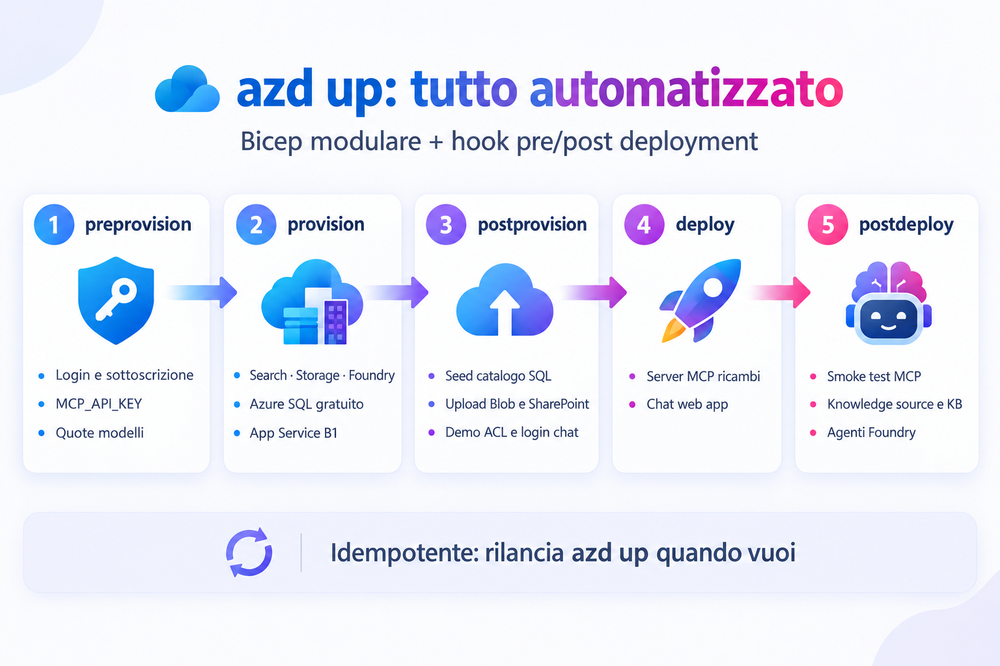
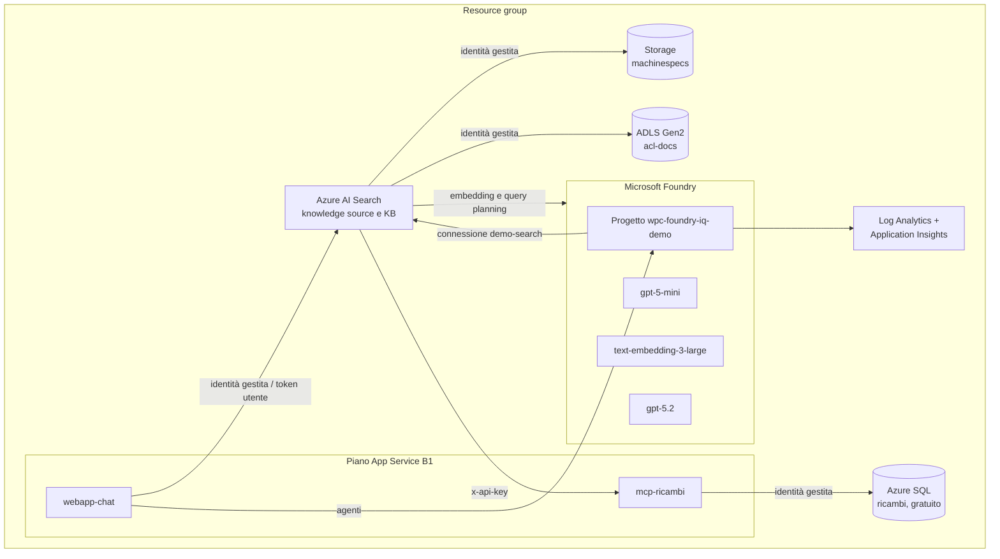
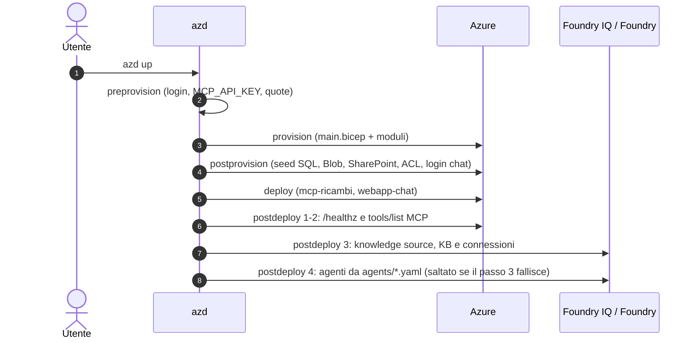
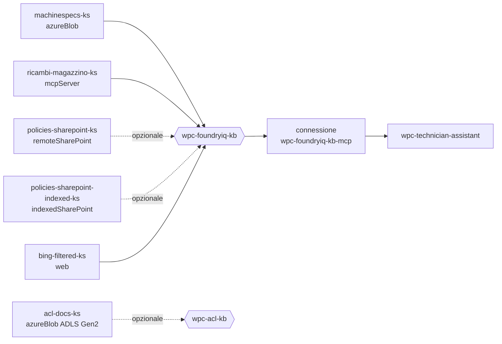
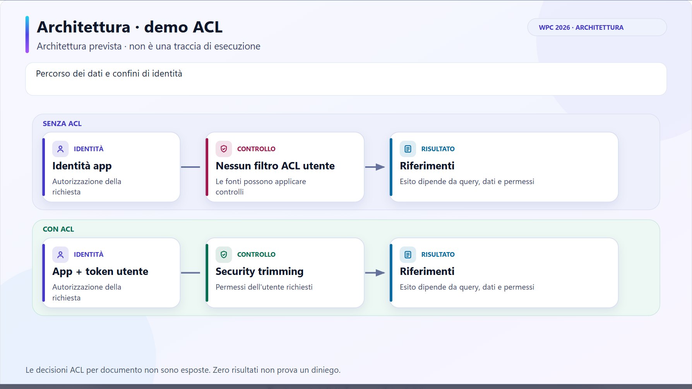
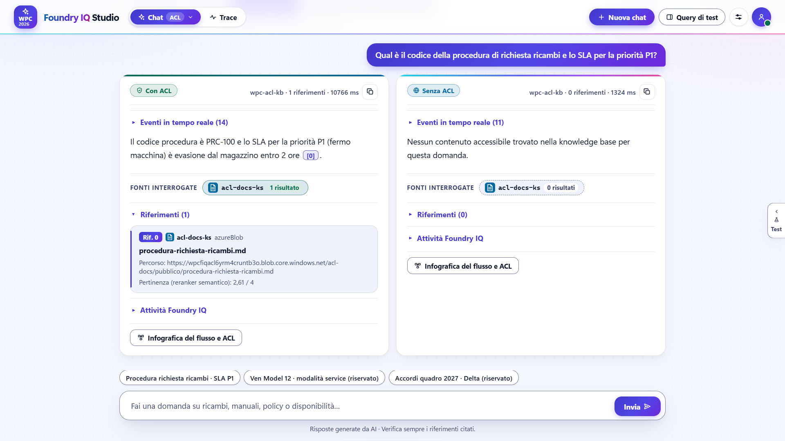

# Infrastruttura della demo Foundry IQ

I template Bicep sono suddivisi in moduli e gli hook di **Azure Developer CLI (`azd`)** automatizzano i passaggi prima e dopo il deployment. Gli stessi moduli e script funzionano anche senza azd (vedi [Deployment](#deployment)); per prerequisiti mancanti o fasi non riuscite, segui [Ripresa dopo un errore](#ripresa-dopo-un-errore). Le risorse possono generare costi; usa solo dati sintetici.

Per mostrare gli scenari senza dipendere dalla connettività in sala, usa la [guida del presentatore e i video offline](../docs/demo-guide.md). La riproduzione degli MP4 locali non richiede risorse Azure; una nuova registrazione esegue invece query reali e può generare costi.



## Risorse



[main.bicep](main.bicep) lavora a livello di sottoscrizione: crea (o riusa) il resource group e orchestra i moduli in [modules](modules/).

| Modulo | Risorse |
|---|---|
| [monitoring.bicep](modules/monitoring.bicep) | Log Analytics (retention 30 giorni) e Application Insights per le tracce degli agenti. |
| [search.bicep](modules/search.bicep) | Azure AI Search con identità gestita, autenticazione Entra. |
| [storage.bicep](modules/storage.bicep) | Storage account e container `machinespecs` (no accesso anonimo, no shared key). |
| [storage-acl.bicep](modules/storage-acl.bicep) | Storage account ADLS Gen2 (namespace gerarchico) e container `acl-docs` per la demo ACL. |
| [foundry.bicep](modules/foundry.bicep) | Risorsa Microsoft Foundry (`AIServices`, S0), progetto `wpc-foundry-iq-demo`, deployment `gpt-5-mini` (Data Zone Standard), `text-embedding-3-large` (Standard) e `gpt-5.2` (Global Standard), connessioni a Search e Application Insights. |
| [role-assignments.bicep](modules/role-assignments.bicep) | Ruoli per l'utente demo, l'identità del progetto Foundry e l'identità di Search. |
| [sql.bicep](modules/sql.bicep) | Azure SQL server con autenticazione solo Entra e database `ricambi` con l'**offerta gratuita** (serverless GP Gen5, 32 GB, sospensione automatica a quota esaurita). |
| [appservice.bicep](modules/appservice.bicep) | Piano App Service Linux (**B1** di default) e Web App Python 3.12 del server MCP `mcp-ricambi`, con identità gestita che legge il database SQL; integrazione VNet quando SQL è privato. |
| [network.bicep](modules/network.bicep) | Solo con `SQL_PRIVATE_ENDPOINT=true`: VNet con subnet per l'integrazione VNet dell'App Service e per i private endpoint, private endpoint SQL e zona DNS privata `privatelink.database.windows.net`. |
| [mcp-identity.bicep](modules/mcp-identity.bicep) | Solo con `SQL_PRIVATE_ENDPOINT=true`: identità gestita assegnata dall'utente del server MCP, amministratore Entra del server SQL. |
| [webapp-chat.bicep](modules/webapp-chat.bicep) | Web App Python 3.12 della [chat Foundry IQ](../webapp-chat/) sullo stesso piano, con identità gestita di sistema e identità gestita assegnata dall'utente usata come federated credential del login Entra. |
| [webapp-chat-roles.bicep](modules/webapp-chat-roles.bicep) | *Search Index Data Reader* su Search, *Cognitive Services OpenAI User* e *Azure AI User* sulla risorsa Foundry per l'identità della chat web app (l'ultimo serve a invocare gli agenti). |
| [demo-config.bicep](modules/demo-config.bicep) | Deployment `wpc-foundry-iq-demo` nel resource group con gli output letti dal notebook (`demoConfig`, `foundryAccountName`, `foundryProjectName`). |

Le risorse usano Microsoft Entra ID: nessuna chiave Azure negli output. L'unico segreto è la `MCP_API_KEY` del server MCP, generata dall'hook e salvata nell'ambiente azd (`.azure/<env>/.env`, escluso da Git) e come app setting della Web App. In un ambiente non demo spostala in Key Vault.

## Prerequisiti

- [Azure Developer CLI](https://aka.ms/azd-install), [Azure CLI](https://aka.ms/azcli), PowerShell 7 (`pwsh`) e Python 3.10 o successivo.
- Node.js 20.19.x oppure 22.12 o successivo, con npm, per compilare il frontend della chat durante il packaging.
- Sottoscrizione con quota per i tre modelli nella regione scelta (default `swedencentral`).
- Permessi per creare il resource group, distribuire le risorse e assegnare ruoli (per esempio **Contributor** e **Role Based Access Control Administrator**). L'utente demo non deve essere Owner.
- Login interattivo di un utente: l'utente autenticato diventa utente demo e, con `SQL_PRIVATE_ENDPOINT=false`, amministratore Entra del server SQL.
- Per SharePoint (opzionale): Microsoft 365 nello **stesso tenant** di Azure, licenza Microsoft 365 Copilot o Retrieval API pay-as-you-go per chi interroga la knowledge base, consenso Microsoft Graph per l'app *Microsoft Graph Command Line Tools* con `Sites.ReadWrite.All` e, se il sito va creato, `Sites.Create.All` (di solito serve un amministratore). Dettagli nella [guida SharePoint](../data/sharepoint/foundry-iq-sharepoint-remote-knowledge-source.md).

## Deployment

Quattro modi per ottenere lo stesso ambiente:

| Opzione | Quando usarla | Strumenti |
|---|---|---|
| **A. azd** (consigliata) | Deployment completo e ripetibile con un solo comando. | `azd up`: Bicep + hook pre/post automatici. |
| **B1. Script + Bicep + script** | azd non disponibile o non ammesso (pipeline esistenti, policy aziendali). | [deploy_noazd.ps1](../scripts/deploy_noazd.ps1): stesse fasi di azd con Azure CLI (`az deployment sub create`, zip deploy) e gli stessi script degli hook, riprendibile da qualsiasi fase. |
| **B2. Creazione manuale** | Per capire o mostrare ogni oggetto, o adattarlo a risorse esistenti. | Portale Azure e portale Foundry, con i moduli Bicep come specifica. |
| **B3. Notebook Jupyter** | Per eseguire e ispezionare ogni passaggio in modo interattivo da VS Code o Jupyter. | [notebooks/deploy](../notebooks/README.md#sequenza-di-deploy-notebooksdeploy) (`01` → `02` → `03`) con Azure CLI, Bicep e SDK Python. |

### Opzione A: azd

Dalla root del repository:

```powershell
azd auth login --tenant-id <tenant-id>
az login --tenant <tenant-id>          # usata dagli hook per SQL, Storage e AI Search
azd env new wpc-foundryiq              # nome ambiente: resource group predefinito rg-wpc-foundryiq
azd env set AZURE_SUBSCRIPTION_ID <subscription-id>
azd env set AZURE_LOCATION swedencentral
azd up
```

`azd up` esegue in sequenza:



**`preprovision`** ([preprovision.ps1](../scripts/preprovision.ps1))

- Verifica il login di Azure CLI e allinea la sottoscrizione e la regione.
- Imposta `AZURE_PRINCIPAL_ID` e `AZURE_PRINCIPAL_NAME` con l'utente autenticato, che diventa l'utente demo.
- Genera `MCP_API_KEY` se assente e controlla le quote dei modelli (solo avviso).

**`provision`**: distribuisce [main.bicep](main.bicep) e i moduli.

**`postprovision`** ([postprovision.ps1](../scripts/postprovision.ps1))

| Passo | Script | Se fallisce |
|---|---|---|
| Crea `.venv` nella root e installa le dipendenze. | | errore |
| Solo con `SQL_PRIVATE_ENDPOINT=false`: apre il firewall SQL all'IP del client, crea lo schema, carica il catalogo e abilita in lettura l'identità della Web App. Con il private endpoint lo fa il server MCP al primo avvio. | [seed_sql.py](../scripts/seed_sql.py) | errore |
| Carica `data/machinespecs` nel container Blob. | | errore |
| Crea il sito SharePoint se non esiste e carica le policy (accesso Microsoft Graph interattivo). | [setup_sharepoint.ps1](../scripts/setup_sharepoint.ps1) | avviso |
| Prepara la demo ACL: gruppi Entra, upload con ACL. | [setup_acl_demo.ps1](../scripts/setup_acl_demo.ps1) | avviso |
| Crea l'app registration e il login Entra della chat, con federated credential e senza segreti. | [setup_chat_auth.ps1](../scripts/setup_chat_auth.ps1) | avviso, la chat resta bloccata (HTTP 401) |
| Stampa i valori per il notebook. | | |

I passi in avviso non fermano `azd up`: a fine hook un riepilogo elenca quelli non riusciti con lo script da rilanciare.

**`deploy`**: pubblica [mcp-ricambi](../mcp-ricambi/) e [webapp-chat](../webapp-chat/) sulle Web App (build Oryx di `requirements.txt`).

**`postdeploy`** ([postdeploy.ps1](../scripts/postdeploy.ps1))

| Passo | Script | Se fallisce |
|---|---|---|
| Attende `/healthz` del server MCP ed esegue uno smoke test (`tools/list`). | | errore immediato |
| Crea knowledge source, knowledge base e connessioni del progetto Foundry. | [setup_foundry_iq.ps1](../scripts/setup_foundry_iq.ps1) | errore a fine hook; il passo agenti viene saltato |
| Crea o aggiorna gli agenti dichiarati in [agents](../agents/). | [setup_foundry_agents.py](../scripts/setup_foundry_agents.py) | errore a fine hook |

Un errore in `postdeploy` fa terminare `azd up` con errore, ma le Web App sono già pubblicate: il messaggio finale indica i passi da riprendere e il comando `azd hooks run postdeploy`.

Gli hook sono idempotenti: puoi rieseguire `azd up`, `azd provision`, `azd deploy` o un singolo hook in qualsiasi momento. Comandi utili:

```powershell
azd deploy mcp-ricambi           # solo il codice del server MCP
azd deploy webapp-chat           # solo il codice della chat
azd hooks run postprovision      # solo dati, SharePoint, ACL e login della chat
azd hooks run postdeploy         # solo Foundry IQ e agenti
```

### Opzione B1: script, Bicep e script (senza azd)

Stessi moduli Bicep e stessi script degli hook, orchestrati da Azure CLI con [deploy_noazd.ps1](../scripts/deploy_noazd.ps1). Le fasi sono le stesse di `azd up`: `preprovision`, `provision` (`az deployment sub create`), `postprovision`, `deploy` (zip deploy con build Oryx) e `postdeploy`. I valori prodotti (chiave MCP, scelte di infrastruttura, client ID della chat, nomi della KB, gruppi ACL) vengono salvati in `.deploy/<ambiente>.local.env`, escluso da git. Così puoi riprendere da qualsiasi fase, anche in una nuova sessione.

```powershell
az login --tenant <tenant-id>

# Opzionale: stesse variabili di main.parameters.json, salvate al primo avvio
$env:APP_SERVICE_SKU = 'B1'; $env:SQL_PRIVATE_ENDPOINT = 'true'; $env:CHAT_CAPACITY = '200'

# Tutte le fasi (resource group: rg-wpc-foundryiq)
./scripts/deploy_noazd.ps1 -EnvironmentName wpc-foundryiq -Location swedencentral -SubscriptionId <subscription-id>

# Ripresa da una fase, oppure una sola fase
./scripts/deploy_noazd.ps1 -EnvironmentName wpc-foundryiq -From deploy
./scripts/deploy_noazd.ps1 -EnvironmentName wpc-foundryiq -Only postdeploy
```

Per lanciare a mano un singolo script (per esempio `./scripts/setup_foundry_iq.ps1`), carica prima i valori nella sessione. [load_env.ps1](../scripts/load_env.ps1) legge il file di stato e gli output del deployment Bicep. Con azd legge invece `azd env get-values`.

```powershell
./scripts/load_env.ps1 -EnvironmentName wpc-foundryiq -NoAzd
./scripts/setup_foundry_iq.ps1
```

Note:

- Il deployment Bicep si chiama `wpc-foundryiq-<ambiente>` e ogni riesecuzione riusa la stessa `mcpApiKey` e lo stesso `chatAuthClientId`. Il login della chat e la connessione MCP restano quindi validi.
- Le variabili `SKIP_*` descritte sotto si impostano nella sessione, per esempio `$env:SKIP_SHAREPOINT_SETUP = 'true'`.
- Se azd è installato ma vuoi l'opzione B1, lo script imposta `WPC_NO_AZD=true`: nessun valore viene scritto negli ambienti azd.

### Opzione B2: creazione manuale degli oggetti

Utile in workshop o per riusare risorse esistenti. I moduli in [modules](modules/) sono la specifica di riferimento (SKU, impostazioni e ruoli); l'ordine consigliato è:

1. **Risorse Azure** (portale Azure), nello stesso resource group:
   - Log Analytics + Application Insights;
   - Azure AI Search (Standard, ranker semantico, identità gestita di sistema) ([search.bicep](modules/search.bicep));
   - due Storage account: uno con il container `machinespecs`, uno ADLS Gen2 (namespace gerarchico) con il container `acl-docs` per la demo ACL ([storage.bicep](modules/storage.bicep), [storage-acl.bicep](modules/storage-acl.bicep));
   - risorsa Foundry con progetto e deployment `gpt-5-mini`, `text-embedding-3-large`, `gpt-5.2`; connessioni del progetto verso Search (`demo-search`) e Application Insights ([foundry.bicep](modules/foundry.bicep));
   - Azure SQL Database con offerta gratuita e amministratore Microsoft Entra (identità gestita assegnata dall'utente della Web App MCP, [mcp-identity.bicep](modules/mcp-identity.bicep)); con le policy che disabilitano l'accesso pubblico servono VNet, private endpoint e integrazione VNet della Web App ([sql.bicep](modules/sql.bicep), [network.bicep](modules/network.bicep));
   - piano App Service Linux B1 con due Web App Python 3.12 (`mcp-ricambi` e `webapp-chat`), con le app setting e il comando di avvio dei moduli [appservice.bicep](modules/appservice.bicep) e [webapp-chat.bicep](modules/webapp-chat.bicep).
2. **Ruoli RBAC**: assegna all'utente demo, all'identità di Search, al progetto Foundry e alle Web App i ruoli dei moduli [role-assignments.bicep](modules/role-assignments.bicep) e [webapp-chat-roles.bicep](modules/webapp-chat-roles.bicep).
3. **Dati e codice**: carica `data/machinespecs` nel container Blob, i PDF di `data/sharepoint/policies/EN` e `IT` nelle rispettive sottocartelle SharePoint e pubblica le due cartelle sulle Web App (Deployment Center o zip deploy come nell'opzione B1). Il server MCP crea lo schema SQL e carica il catalogo al primo avvio.
4. **Foundry IQ** (portale Foundry, *Knowledge*): crea le knowledge source e le knowledge base della tabella qui sotto, con le stesse descrizioni; per `ricambi-magazzino-ks` usa l'URL `/mcp` della Web App, l'header `x-api-key` e al massimo 5 tool.
5. **Connessioni e agenti** (portale Foundry): crea le connessioni `wpc-foundryiq-kb-mcp` e `mcp-ricambi-key` descritte sotto, poi gli agenti con istruzioni e tool dei file in [agents](../agents/README.md).

### Opzione B3: notebook Jupyter di deploy

I tre notebook in [notebooks/deploy](../notebooks/README.md#sequenza-di-deploy-notebooksdeploy) eseguono le stesse operazioni direttamente in celle Python (`01-infrastruttura.ipynb` → `02-dati-identita-app.ipynb` → `03-foundry-iq-agenti.ipynb`), leggendo la configurazione dagli output del deployment ARM `wpc-foundryiq-<ambiente>` senza file di stato locali. I prerequisiti e i notebook di verifica per scenario sono descritti in [notebooks/README.md](../notebooks/README.md).

Con `LOAD_AZD_ENV = True` nella prima cella, [notebook_env.py](../scripts/notebook_env.py) precompila subscription, ambiente e nome del deployment dai valori azd; nel notebook 01 anche regione/resource group e nel 03 i nomi KB/URL policy. `AZD_ENVIRONMENT_NAME = ""` usa l'ambiente selezionato, un nome esplicito non cambia la selezione azd. Il flag è disattivato per default e non attiva `RUN_DEPLOY`: parametri Bicep e operazioni restano espliciti. Se il deployment ARM creato da azd ha un nome diverso da quello calcolato, indica il nome effettivo in `DEPLOYMENT_NAME`.

## Ripresa dopo un errore

Ogni fase è idempotente: correggi la causa (vedi [Risoluzione dei problemi](#risoluzione-dei-problemi)) e riprendi dalla fase non riuscita, senza ripetere quelle già completate. Se è fallito un solo passo opzionale, basta rilanciare il relativo script.

| Fase non riuscita | Cosa resta in Azure | Ripresa con azd (opzione A) | Ripresa senza azd (opzione B1) |
|---|---|---|---|
| `preprovision` (login, tenant, SKU F1 con private endpoint) | nulla | `azd up` | `deploy_noazd.ps1 -EnvironmentName <env>` |
| `provision` (quota, policy, nome già in uso, sottoscrizione disabilitata) | le risorse già create; il deployment Bicep è in stato `Failed` | `azd provision`, poi `azd deploy` | `-From provision` |
| `postprovision` 1-3: venv, seed SQL, upload Blob | tutte le risorse | `azd hooks run postprovision`, poi `azd deploy` | `-From postprovision` |
| `postprovision` 4-6: SharePoint, ACL, login della chat (avvisi) | tutto; manca solo il passo in avviso | lo script indicato nel riepilogo (per esempio `./scripts/setup_chat_auth.ps1`), poi `azd hooks run postdeploy` per aggiornare la KB | lo script indicato, dopo `load_env.ps1`, poi `-Only postdeploy` |
| `deploy` (build Oryx, timeout zip deploy) | risorse configurate; codice vecchio o assente | `azd deploy` (o `azd deploy <servizio>`) | `-From deploy` |
| `postdeploy` 1-2: `/healthz` o `tools/list` | tutto pubblicato; il server MCP non risponde | controlla i log (`az webapp log tail`), poi `azd deploy mcp-ricambi` | `-From deploy` |
| `postdeploy` 3-4: Foundry IQ o agenti | Web App pubblicate e funzionanti | `azd hooks run postdeploy` | `-Only postdeploy` |

Nella colonna "senza azd", `-From` e `-Only` sono parametri di `./scripts/deploy_noazd.ps1 -EnvironmentName <env>`.

Altri casi:

- **Passo opzionale da escludere** (per esempio niente Microsoft 365 nel tenant): `azd env set SKIP_SHAREPOINT_SETUP true`, oppure `$env:SKIP_SHAREPOINT_SETUP = 'true'` senza azd, poi riprendi. Gli altri flag sono `SKIP_ACL_DEMO_SETUP`, `SKIP_CHAT_AUTH_SETUP`, `SKIP_FOUNDRY_IQ_SETUP` e `SKIP_FOUNDRY_AGENTS_SETUP`.
- **Da azd a script**, quando azd si blocca su una fase: `./scripts/load_env.ps1` carica l'ambiente azd nella sessione e i singoli script funzionano senza azd. I valori che salvano finiscono comunque nell'ambiente azd.
- **Ripartire da zero**: `azd down --purge`. Senza azd: `az group delete -n rg-<env>`, poi `az cognitiveservices account purge` per la risorsa Foundry ed elimina `.deploy/<env>.local.env`. Gruppi Entra, app registration e sito SharePoint vanno eliminati a mano.

## Oggetti Foundry IQ

L'hook `postdeploy` crea questi oggetti sul servizio Search (API `2026-11-01-preview`) con [setup_foundry_iq.ps1](../scripts/setup_foundry_iq.ps1):



| Nome | Tipo | Contenuto |
|---|---|---|
| `machinespecs-ks` | Knowledge source `azureBlob` | Descrizione: manuali tecnici delle macchine. Legge il container `machinespecs`, indicizzato con `text-embedding-3-large`. |
| `ricambi-magazzino-ks` | Knowledge source `mcpServer` | Descrizione: ricerca ricambi, disponibilità, alternative, ordini aperti e articoli sotto scorta. Interroga i tool MCP in tempo reale. |
| `policies-sharepoint-ks` | Knowledge source `remoteSharePoint` | Descrizione: policy aziendali per i tecnici. Cartella `policies`, filtrata per `Path`, interrogata in tempo reale con l'identità dell'utente. Creata solo se `setup_sharepoint.ps1` è riuscito. |
| `policies-sharepoint-indexed-ks` | Knowledge source `indexedSharePoint` | Policy nella cartella `policies` e sottocartelle EN/IT, importate in Search con `text-embedding-3-large` e ACL `userIds, groupIds`. Creata se è configurata `SHAREPOINT_INDEXED_CONNECTION_STRING`, senza sostituire la sorgente remota. |
| `bing-filtered-ks` | Knowledge source `web` | Descrizione: ricerca web Bing per informazioni aggiornate sui ricambi. Limitata ai domini in `FOUNDRYIQ_BING_ALLOWED_DOMAINS`. |
| `wpc-foundryiq-kb` | Knowledge base | Descrizione: assistente tecnici WPC con manuali, magazzino, policy e ricerca web filtrata. Combina le sorgenti disponibili, con modello chat completions `gpt-5.2`, reasoning effort `low` e `retrievalInstructions` definite nello script. |
| `acl-docs-ks` | Knowledge source `azureBlob` (ADLS Gen2) | Descrizione: documenti interni con permessi per documento. Importa le ACL POSIX (`ingestionPermissionOptions: userIds, groupIds`). Creata solo se la demo ACL è stata preparata. |
| `wpc-acl-kb` | Knowledge base | Demo ACL: contiene solo `acl-docs-ks`, reasoning effort `minimal`, per osservare il filtro dei permessi. |

La knowledge source Bing usa un'allowlist, predefinita a `grainger.com,mcmaster.com,rs-online.com,digikey.com,mouser.com,misumi-ec.com,automationdirect.com`. Il web grounding Bing può comportare costi aggiuntivi e i dati inviati al servizio web sono soggetti ai relativi termini e confini di conformità, non a quelli Azure; usa solo contenuti appropriati per la ricerca web.

Le `retrievalInstructions` guidano la pianificazione verso le sorgenti pertinenti e, per le domande multi-fonte, combinano manuali, magazzino, policy e web quando disponibili. Sono applicate alla KB dall'hook `postdeploy` e non modificano le ACL né le istruzioni usate dalla chat per sintetizzare la risposta. Per configurarle manualmente, inserisci nel campo **Retrieval instructions** il testo seguente, adattando i nomi delle sorgenti e omettendo SharePoint se non configurato:

```text
Pianifica ricerche distinte per gli aspetti della domanda e usa le sorgenti pertinenti; combina più sorgenti quando la richiesta lo richiede.
Usa 'machinespecs-ks' per manuali, specifiche delle macchine, manutenzione e troubleshooting.
Usa 'ricambi-magazzino-ks' per ricambi, giacenze, sottoscorta, ordini e alternative; scegli i tool pertinenti come search_parts, check_stock, low_stock_report e find_alternative_parts.
Usa 'policies-sharepoint-ks' per policy aziendali, sicurezza e procedure, rispettando i permessi dell'utente.
Usa 'bing-filtered-ks' per cataloghi, fornitori e informazioni pubbliche aggiornate; non includere dati riservati nelle ricerche web.
Mantieni esatti i nomi delle macchine e i codici dei ricambi. Non presumere disponibilità, date di consegna o autorizzazioni non presenti nelle fonti.
```

Sul progetto Foundry viene creata anche la connessione `wpc-foundryiq-kb-mcp` (`RemoteTool`, identità gestita del progetto) verso l'endpoint MCP della knowledge base: gli agenti la usano con il tool `knowledge_base_retrieve`. L'hook salva nell'ambiente azd `FOUNDRYIQ_DEMO_KB_NAME`, `FOUNDRYIQ_DEMO_KB_MCP_ENDPOINT` e `FOUNDRYIQ_DEMO_KB_CONNECTION`. La knowledge base compare nel portale Foundry tramite la connessione Search `demo-search`.

Viene creata anche la connessione `mcp-ricambi-key` (`RemoteTool`, *Custom keys* con header `x-api-key`) verso il server MCP ricambi, salvata in `FOUNDRYIQ_MCP_CONNECTION`: la chiave resta nella connessione e non compare nelle definizioni degli agenti.

## Agenti Foundry (agents-as-code)

L'ultimo passo del `postdeploy` legge i file YAML in [agents](../agents/) e crea, con l'SDK `azure-ai-projects`, questi Prompt Agent:

- `wpc-technician-assistant`: knowledge base Foundry IQ;
- `wpc-magazzino-assistant`: server MCP ricambi diretto;
- `wpc-rag-classico-rapido` e `wpc-rag-classico-accurato`: RAG classico con Azure AI Search sull'indice della knowledge source Blob, MCP ricambi e web search sui domini Bing consentiti.

Le variabili che servono agli agenti arrivano dall'hook Foundry IQ (`FOUNDRYIQ_DEMO_KB_*`, `FOUNDRYIQ_DEMO_BLOB_INDEX`, `FOUNDRYIQ_BING_ALLOWED_DOMAINS`) e da Bicep (`FOUNDRYIQ_SEARCH_CONNECTION_ID`, connessione `demo-search`): se il passo Foundry IQ fallisce, il passo agenti viene saltato e l'hook indica il comando di ripresa. Il passo è idempotente: una nuova versione viene creata solo se la definizione cambia. Lo schema dei file è nel [README degli agenti](../agents/README.md).

Gli agenti nativi di azd (`host: azure.ai.agent`) supportano solo agenti hosted o con harness gestito: per questo i Prompt Agent sono creati dall'hook.

La sorgente SharePoint **remota** usa la Microsoft 365 Copilot Retrieval API con il token delegato dell'utente: la chat tenta di inoltrarlo anche in **Senza ACL** sulla KB multi-fonte, perché SharePoint applica comunque i propri permessi. Nella modalità **Agenti RAG vs IQ** la chat usa invece il contesto del progetto senza inoltrare un token utente, quindi SharePoint di norma non restituisce risultati. Licenze e risoluzione dei problemi sono nella [guida SharePoint](../data/sharepoint/foundry-iq-sharepoint-remote-knowledge-source.md).

### SharePoint indexed

Per aggiungere anche `policies-sharepoint-indexed-ks`, configura un'app Entra per l'ingestion con **application permissions** e consenso amministrativo, separata dall'accesso Graph delegato usato per caricare i PDF. Per i file con ACL di utenti/gruppi Entra servono Microsoft Graph `Files.Read.All` e `Sites.FullControl.All` oppure `Sites.Selected` con grant esplicito sui siti. Segui i [prerequisiti dell'indexer](https://learn.microsoft.com/azure/search/search-how-to-index-sharepoint-online) e la [matrice dei permessi ACL](https://learn.microsoft.com/azure/search/search-indexer-sharepoint-access-control-lists#permissions-by-acl-scenario).

Il postprovision esegue `scripts/setup_sharepoint_indexed.ps1`, che automatizza questa configurazione: crea l'app `wpc-foundryiq-sp-ingestion-<env>`, concede `Files.Read.All` e `Sites.FullControl.All` (serve Global Administrator o Privileged Role Administrator), aggiunge la credenziale federata con l'identità system-assigned di Search e salva `SHAREPOINT_INDEXED_CONNECTION_STRING`; il postdeploy crea poi la knowledge source. Se il consenso non riesce, un amministratore può concederlo dal portale Entra e poi rilanciare lo script. Una connessione impostata a mano non viene sovrascritta; `SKIP_SHAREPOINT_INDEXED_SETUP=true` salta il passo.

Per configurarla manualmente imposta `SHAREPOINT_INDEXED_CONNECTION_STRING` nell'ambiente e riesegui `scripts/setup_foundry_iq.ps1` dopo aver caricato la configurazione con `scripts/load_env.ps1`. Il formato secretless raccomandato, con credenziale federata che attesta l'identità gestita **system-assigned di Search**, è:

```text
SharePointOnlineEndpoint=https://<tenant>.sharepoint.com/sites/wpc-foundry-iq-demo;ApplicationId=<client-id-app-ingestion>;FederatedCredentialApplicationId=<client-id-managed-identity-search>;TenantId=<tenant-id-sharepoint>
```

Per il solo scenario Graph con utenti/gruppi Entra è supportato anche `ApplicationSecret=<secret>` al posto di `FederatedCredentialApplicationId`. Non salvare segreti in file versionati, notebook o output condivisi. Non usare l'app pubblica di login Graph come app di ingestion.

Lo script usa `containerName: useQuery` e `includeFolder=<SHAREPOINT_POLICIES_URL>` per non importare il resto del sito; puoi specificare una selezione diversa con `SHAREPOINT_INDEXED_QUERY`. Senza URL della cartella né query esplicita il setup fallisce prima di modificare Search. La sorgente remota resta disponibile; le retrieval instructions distinguono ricerca live e contenuti indicizzati, evitando duplicazioni.

L'indicizzazione genera datasource, skillset, indice e indexer; la creazione della sorgente non prova che l'ingestion sia completata. Verifica lo stato dell'indexer in Search e prova utenti autorizzati/non autorizzati. Per default l'indexer della knowledge source viene eseguito ogni 24 ore: contenuti e ACL non sono verificati live. Lo script importa `userIds`/`groupIds`, senza rimuovere i permessi per rendere i dati accessibili agli agenti. Per l'enforcement il client deve fornire il token utente in `x-ms-query-source-authorization`; senza tale contesto i documenti protetti non sono disponibili. I gruppi nativi SharePoint richiedono anche credenziale federata, permessi SharePoint e configurazione `sharePointConnectorAppRegistration` sul servizio Search: il solo setup della knowledge source non la configura.

## Demo ACL (permessi per documento)



[setup_acl_demo.ps1](../scripts/setup_acl_demo.ps1) crea, se non esistono, i gruppi di sicurezza Entra **WPC FoundryIQ ACL - Tecnici** e **WPC FoundryIQ ACL - Direzione**. Rende l'utente corrente owner di entrambi e membro solo di *Tecnici*. Poi carica [data/acl](../data/acl/) nel container `acl-docs` con queste ACL ([setup_acl_docs.py](../scripts/setup_acl_docs.py)):

| Cartella | Gruppi con lettura |
|---|---|
| `pubblico/` | Tecnici, Direzione |
| `manutenzione-riservata/` | Tecnici |
| `direzione-riservata/` | Direzione |

Il notebook [demo-acl.ipynb](../notebooks/demo/demo-acl.ipynb) legge per default l'ambiente azd selezionato; con `CONFIG_SOURCE = "arm"` usa gli output del deployment ARM indicato in `DEPLOYMENT_NAME`, come quello creato dai notebook in [notebooks/deploy](../notebooks/deploy/). Interroga la KB ACL senza e con il token sorgente dell'utente corrente, confrontando i documenti con l'appartenenza reale a Tecnici/Direzione e le ACL ADLS, senza cambiare gruppi. Il precedente [acl-demo.ipynb](../acl-demo.ipynb) resta un esempio legacy con cambio di appartenenza. Per riusare gruppi esistenti imposta `FOUNDRYIQ_ACL_GROUP_TECNICI_ID` e `FOUNDRYIQ_ACL_GROUP_DIREZIONE_ID` prima di `azd provision`. Serve il permesso di creare gruppi in Entra ID (consentito agli utenti per default, salvo restrizioni del tenant).

All'utente demo viene assegnato *Storage Blob Data Owner* sull'account ACL per caricare i file e impostare le ACL. Non aggira il filtro, perché la knowledge source importa solo `userIds`/`groupIds` e non `rbacScope`. L'agente Foundry collegato con l'identità gestita del progetto non porta l'identità dell'utente: per l'enforcement end-to-end il client deve inoltrare il token utente nell'header `x-ms-query-source-authorization`.

[](../docs/images/chat-acl.png)

Il [video ACL](../docs/videos/demo-acl.mp4) conserva una sessione locale con Azure CLI: mostra richieste effettive, non prova tutti i profili utente né il login Easy Auth. Non attribuire automaticamente un risultato vuoto al filtro ACL.

## Variabili dell'ambiente azd

Imposta i valori con `azd env set <NOME> <valore>` prima di `azd up` o `azd provision`; senza azd usa `$env:<NOME> = '<valore>'` nella stessa sessione degli script.

| Variabile | Default | Descrizione |
|---|---|---|
| `AZURE_LOCATION` | `swedencentral` | Regione di Search, Storage, Foundry e App Service. |
| `AZURE_RESOURCE_GROUP` | `rg-<nome ambiente>` | Resource group da creare o riusare. |
| `CHAT_CAPACITY` / `EMBEDDING_CAPACITY` / `GPT52_CAPACITY` | `200` / `20` / `200` | Capacità (K TPM) dei deployment dei modelli. |
| `APP_SERVICE_SKU` | `B1` | SKU del piano App Service: `F1` (gratuito, senza Always On, avvio lento), `B1`, `B2`, `B3`, `S1`, `P0v3`. |
| `SQL_PRIVATE_ENDPOINT` | `true` | SQL senza accesso pubblico, raggiungibile solo tramite private endpoint (richiesto dalle policy che impongono `publicNetworkAccess=Disabled`). Il server MCP carica i dati da solo (`SQL_AUTO_SEED`). Richiede uno SKU App Service diverso da `F1`; private endpoint e traffico possono comportare costi variabili. Con `false` SQL è pubblico con firewall e il `postprovision` carica i dati dalla macchina locale. |
| `SQL_LOCATION` | regione principale | Regione del server SQL, se la regione principale non accetta nuovi server SQL. |
| `SQL_USE_FREE_LIMIT` | `true` | Offerta gratuita Azure SQL (massimo 10 database per sottoscrizione). Imposta `false` se l'offerta è esaurita: il database diventa serverless a pagamento. |
| `MCP_API_KEY` | generata | Chiave `x-api-key` del server MCP. |
| `SKIP_FOUNDRY_IQ_SETUP` | `false` | `true` per non creare knowledge source e knowledge base nel `postdeploy`. |
| `SKIP_FOUNDRY_AGENTS_SETUP` | `false` | `true` per non creare gli agenti Foundry di [agents](../agents/) nel `postdeploy`. |
| `FOUNDRYIQ_BING_ALLOWED_DOMAINS` | `grainger.com,mcmaster.com,rs-online.com,digikey.com,mouser.com,misumi-ec.com,automationdirect.com` | Domini consentiti per la knowledge source Bing, separati da virgola o punto e virgola. Usa host senza `https://` o percorsi. |
| `SKIP_SHAREPOINT_SETUP` | `false` | `true` per saltare sito, upload e knowledge source SharePoint (es. tenant Microsoft 365 diverso da quello Azure). |
| `SKIP_ACL_DEMO_SETUP` | `false` | `true` per saltare gruppi, upload, knowledge source e knowledge base della demo ACL. |
| `FOUNDRYIQ_ACL_GROUP_TECNICI_ID` / `FOUNDRYIQ_ACL_GROUP_DIREZIONE_ID` | creati dall'hook | Object ID di gruppi Entra esistenti da usare per la demo ACL. |
| `SKIP_CHAT_AUTH_SETUP` | `false` | `true` per non creare l'app registration e il login Entra della chat web app (serve il permesso di creare app registration; l'admin consent è facoltativo). In questo caso la chat resta bloccata (HTTP 401). |
| `CHAT_APP_CLIENT_ID` | impostata da `setup_chat_auth.ps1` | Client ID dell'app registration della chat. Con questo valore i provisioning successivi applicano il login completo direttamente da Bicep. |
| `SHAREPOINT_SITE_URL` | `https://<tenant>.sharepoint.com/sites/wpc-foundry-iq-demo` | Sito da usare; se non esiste viene creato come communication site. Dopo il primo run contiene l'URL effettivo. |
| `SHAREPOINT_FOLDER` | `policies` | Cartella della raccolta documenti predefinita in cui caricare i PDF. |
| `SHAREPOINT_INDEXED_CONNECTION_STRING` | _(creata da `setup_sharepoint_indexed.ps1`)_ | Connessione dell'app di ingestion per aggiungere `policies-sharepoint-indexed-ks` con ACL. Preferire credenziale federata dell'identità system-assigned Search; l'accesso Graph delegato per l'upload non basta. `SKIP_SHAREPOINT_SETUP=true` salta anche questa sorgente. |
| `SKIP_SHAREPOINT_INDEXED_SETUP` | `false` | `true` non crea l'app di ingestion né la connessione per la sorgente SharePoint indexed. |
| `SHAREPOINT_INDEXED_QUERY` | `includeFolder=<SHAREPOINT_POLICIES_URL>` | Selezione dei contenuti per l'indexer (`useQuery`), distinta dal filtro KQL della sorgente remota. Obbligatoria se manca l'URL della cartella. |
| `SHAREPOINT_USE_DEVICE_CODE` | `false` | `true` per accedere a Microsoft Graph con device code invece del browser. |
| `SHAREPOINT_GRAPH_AUTH` | _(modulo)_ | `rest` per non usare il modulo `Microsoft.Graph.Authentication` e accedere a Graph via OAuth + REST. Si attiva da solo se il modulo non è installabile (es. PowerShell Gallery bloccata dal proxy aziendale). |

## Verifica e pulizia

L'output di `azd env get-values` può contenere `MCP_API_KEY`: non pubblicarlo né condividerlo.

```powershell
azd env get-values                                  # output del deployment
Invoke-RestMethod (azd env get-value MCP_HEALTH_URL)  # {"status":"ok","inventory":{"source":"sql",...}}
azd down --purge                                    # elimina tutte le risorse (Foundry e Search inclusi)
```

## Risoluzione dei problemi

| Sintomo | Causa e soluzione |
|---|---|
| Prima risposta del server MCP lenta, `/healthz` riporta `json-fallback` | Il database gratuito si sospende dopo 60 minuti di inattività. Il server ritenta la connessione e nel frattempo usa il catalogo JSON incluso. |
| `provision` del database fallisce con un errore generico | Offerte gratuite Azure SQL della sottoscrizione esaurite: imposta `SQL_USE_FREE_LIMIT=false`. |
| `DenyPublicEndpointEnabled` | Una policy disabilita l'accesso pubblico a SQL: usa `SQL_PRIVATE_ENDPOINT=true` (default). |
| SQL non raggiungibile dalla tua macchina | Atteso con `SQL_PRIVATE_ENDPOINT=true`: l'amministratore Entra è l'identità gestita del server MCP. Con `false` il firewall ammette i servizi Azure e l'IP del client dell'ultimo `postprovision` (regola `azd-client`). |
| `Tools must not contain more than 5 tools` | Una knowledge source `mcpServer` accetta al massimo 5 tool: `list_machine_parts` resta disponibile solo agli agenti. |
| `variabili mancanti FOUNDRYIQ_DEMO_KB_...` nel `postdeploy` | Il passo Foundry IQ è fallito prima. Correggi la causa e rilancia `azd hooks run postdeploy` (senza azd: `./scripts/deploy_noazd.ps1 -EnvironmentName <env> -Only postdeploy`). Vedi [Ripresa dopo un errore](#ripresa-dopo-un-errore). |
| La chat risponde HTTP 401 a ogni richiesta | Il login Entra non è configurato: esegui `pwsh ./scripts/setup_chat_auth.ps1`. |
| Nessun risultato da SharePoint | Serve l'identità dell'utente e una licenza adeguata: vedi la [guida SharePoint](../data/sharepoint/foundry-iq-sharepoint-remote-knowledge-source.md). |
