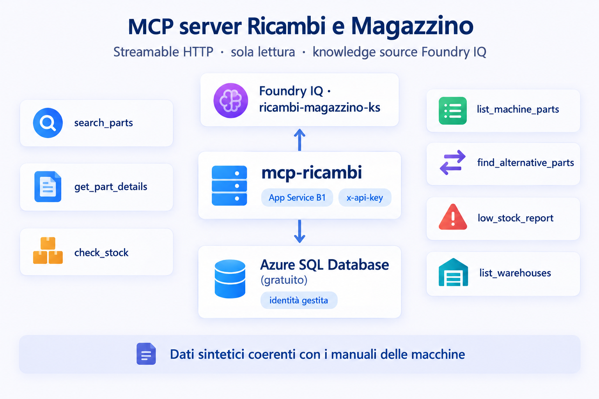
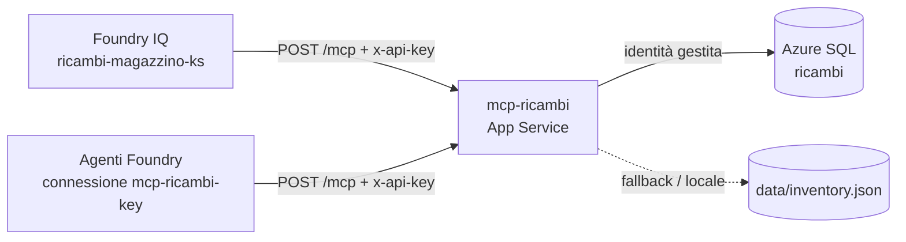

# MCP server Ricambi e Magazzino

Server **MCP su HTTP (Streamable HTTP, stateless)** per la ricerca di ricambi e giacenze di magazzino delle macchine descritte in [data/machinespecs](../data/machinespecs/). È pensato per essere collegato a **Foundry IQ** come [MCP Server knowledge source](https://learn.microsoft.com/azure/search/agentic-knowledge-source-how-to-mcp-server): Foundry IQ interroga i tool in tempo reale al momento del retrieve, senza indicizzazione.





Il catalogo in [data/inventory.json](data/inventory.json) è **sintetico**: i part number derivano dalle liste componenti dei manuali, mentre giacenze, ubicazioni, fornitori, costi e ordini sono inventati per la demo. In Azure lo stesso catalogo è caricato in **Azure SQL Database** (tabelle `warehouses`, `parts`, `part_stock`, `purchase_orders`, `part_alternates`, definite in [sql_source.py](sql_source.py)) e il server lo legge con la propria identità gestita; in locale usa il file JSON.

La [registrazione multi-fonte](../docs/videos/demo-multi-fonte.mp4) e il [confronto agenti](../docs/videos/demo-agenti.mp4) mostrano query effettive ai servizi della demo, con disponibilità dei ricambi e tool osservati. **Servizio reale non significa catalogo reale di un cliente**. Il server può leggere dalla cache SQL o dal fallback JSON: per identificare la sorgente attiva controlla `/healthz`, non dedurla dalla risposta del modello. [Copione e piano di riserva offline](../docs/demo-guide.md).

## Tool esposti

Tutti i tool sono in sola lettura e restituiscono `{ "count": n, "results": [ { "id", "title", "content", ... } ] }`, dove `content` è un riepilogo testuale autosufficiente utile al reranker e i restanti campi sono strutturati.

| Tool | Uso | KS Foundry IQ |
|---|---|---|
| `search_parts` | Ricerca full-text (italiano o inglese, tollera refusi) con filtri per macchina, categoria, magazzino e disponibilità. | ✓ |
| `get_part_details` | Scheda completa di un part number. | ✓ |
| `check_stock` | Disponibilità (giacenza − impegnato) di uno o più part number, totale o per magazzino, con prossima consegna. | ✓ |
| `find_alternative_parts` | Ricambi alternativi approvati e loro disponibilità. | ✓ |
| `low_stock_report` | Ricambi esauriti o sotto punto di riordino, ordinati per criticità. | ✓ |
| `list_machine_parts` | Distinta ricambi di una macchina con stato scorte. | solo agenti |
| `list_warehouses` | Magazzini (`WH-MAIN`, `WH-LINE-A`, `WH-LINE-B`, `VAN-SVC-01`) e riepilogo giacenze. | solo agenti |

Una knowledge source `mcpServer` accetta al massimo 5 tool: `ricambi-magazzino-ks` usa quelli marcati ✓. Gli agenti con MCP diretto scelgono i propri tool con `allowed_tools` (vedi [agents](../agents/README.md)).

Endpoint: `POST /mcp` (MCP) e `GET /healthz` (stato e sorgente dati attiva).

## Esecuzione locale

Da PowerShell, nella cartella `mcp-ricambi`:

```powershell
python -m venv .venv
.\.venv\Scripts\python.exe -m pip install -r .\requirements.txt
$env:MCP_API_KEY = '<chiave-a-scelta>'   # opzionale: se assente /mcp non richiede autenticazione
.\.venv\Scripts\python.exe .\server.py   # http://127.0.0.1:8000/mcp
```

Variabili d'ambiente:

| Variabile | Default | Descrizione |
|---|---|---|
| `MCP_API_KEY` | _(vuota)_ | Se valorizzata, `/mcp` richiede l'header `x-api-key` con questo valore. Impostala sempre quando il server è raggiungibile da Internet. |
| `HOST` / `PORT` | `127.0.0.1` / `8000` | Indirizzo di ascolto (`0.0.0.0` nel container). |
| `MCP_ALLOWED_HOSTS` | _(vuota)_ | Elenco separato da virgole di header `Host` ammessi (protezione DNS rebinding), es. `mcp.contoso.com,localhost:8000`. |
| `INVENTORY_FILE` | `data/inventory.json` | Percorso alternativo del catalogo. |
| `INVENTORY_SOURCE` | `json` | `json` (file) oppure `sql` (Azure SQL Database). |
| `SQL_SERVER` / `SQL_DATABASE` | | FQDN del server e nome del database quando `INVENTORY_SOURCE=sql`. |
| `SQL_AUTHENTICATION` | `ActiveDirectoryDefault` | `ActiveDirectoryMSI` su App Service; in locale usa il login di Azure CLI. |
| `SQL_CLIENT_ID` | _(vuota)_ | Client ID dell'identità gestita assegnata dall'utente da usare con `ActiveDirectoryMSI`. |
| `SQL_AUTO_SEED` | `false` | Se `true`, al primo accesso il server crea lo schema e carica `data/inventory.json` nel database (ricarica solo se il file cambia). Usato quando SQL è raggiungibile solo tramite private endpoint. |
| `INVENTORY_CACHE_SECONDS` | `300` | Durata della cache dei dati letti da SQL. |
| `INVENTORY_FALLBACK_TO_JSON` | `false` | Se `true` e SQL non è raggiungibile, usa il file JSON. `/healthz` indica la sorgente attiva. |

Per leggere da SQL in locale (solo con `SQL_PRIVATE_ENDPOINT=false`: il tuo IP deve essere ammesso nel firewall, operazione svolta dal `postprovision`):

```powershell
$env:INVENTORY_SOURCE = 'sql'
$env:SQL_SERVER = azd env get-value SQL_SERVER_FQDN
$env:SQL_DATABASE = azd env get-value SQL_DATABASE_NAME
.\.venv\Scripts\python.exe .\server.py
```

Per provare i tool puoi usare [MCP Inspector](https://github.com/modelcontextprotocol/inspector) (`npx @modelcontextprotocol/inspector`), trasporto **Streamable HTTP**, URL `http://127.0.0.1:8000/mcp` e header `x-api-key`.

Test:

```powershell
.\.venv\Scripts\python.exe -m pip install pytest httpx
.\.venv\Scripts\python.exe -m pytest -q
```

## Pubblicazione su Azure App Service

`azd up` (o `azd deploy mcp-ricambi` per il solo codice) dalla root del repository pubblica il server sulla Web App Linux creata da [appservice.bicep](../infra/modules/appservice.bicep): piano **B1** (configurabile con `APP_SERVICE_SKU`), Python 3.12, solo HTTPS, avvio con `uvicorn`. Le app setting impostano `INVENTORY_SOURCE=sql`, `SQL_AUTO_SEED=true` e `INVENTORY_FALLBACK_TO_JSON=true`; `MCP_API_KEY` è generata dall'hook `preprovision` e il database è letto con l'identità gestita. I file esclusi dal pacchetto sono in [.webappignore](.webappignore).

```powershell
azd env get-value MCP_SERVER_URL   # https://<web-app>.azurewebsites.net/mcp
$env:MCP_API_KEY = azd env get-value MCP_API_KEY  # carica senza stampare la chiave
az webapp log tail -g (azd env get-value AZURE_RESOURCE_GROUP) -n (azd env get-value MCP_APP_NAME)
```

Il [Dockerfile](Dockerfile) resta disponibile per altri host di container; per una prova senza Azure puoi esporre il server locale con [Dev Tunnels](https://learn.microsoft.com/azure/developer/dev-tunnels/) (`devtunnel host -p 8000 --allow-anonymous`), lasciando l'autenticazione a `MCP_API_KEY`.

## Collegamento a Foundry IQ

L'hook `postdeploy` esegue [setup_foundry_iq.ps1](../scripts/setup_foundry_iq.ps1) (oppure l'equivalente passo in [03-foundry-iq-agenti.ipynb](../notebooks/deploy/03-foundry-iq-agenti.ipynb)), che crea la knowledge source `ricambi-magazzino-ks` di tipo `mcpServer` e la aggiunge alla knowledge base `wpc-foundryiq-kb`. Per rieseguirlo da terminale: `pwsh ./scripts/setup_foundry_iq.ps1`. Lo smoke test di `/healthz` e `tools/list` e le chiamate dell'agente `wpc-magazzino-assistant` sono verificabili anche in [demo-agenti.ipynb](../notebooks/demo/demo-agenti.ipynb).

Esempi di domande:

- *"Abbiamo in magazzino la membrana filtro del Graphene Vapor Reclaim Tank?"*
- *"Il Safety Interlock Switch della Rx1 è esaurito: ci sono alternative?"*
- *"Quali ricambi critici sono sotto scorta?"*

### Definizione della knowledge source

Per riferimento, o per crearla a mano, questa è la definizione inviata (API `2026-11-01-preview`). L'header `x-api-key` è salvato come `storedHeaders`: è write-only e viene mascherato in lettura.

```powershell
$search = azd env get-value SEARCH_SERVICE_NAME
$mcpUrl = azd env get-value MCP_SERVER_URL
$apiKey = azd env get-value MCP_API_KEY
$body = @{
  name = 'ricambi-magazzino-ks'
  kind = 'mcpServer'
  description = 'Catalogo ricambi e giacenze di magazzino: ricerca ricambi, disponibilità, alternative, ordini aperti, ricambi sotto scorta.'
  resultsProcessing = 'rerank'
  mcpServerParameters = @{
    serverURL = $mcpUrl
    authentication = @{ kind = 'storedHeaders'; storedHeadersParameters = @{ headers = @{ 'x-api-key' = $apiKey } } }
    # Massimo 5 tool per knowledge source mcpServer: gli altri restano disponibili agli agenti.
    tools = @(
      'search_parts', 'get_part_details', 'check_stock', 'find_alternative_parts', 'low_stock_report'
    ) | ForEach-Object {
      @{ name = $_; resultsProcessing = 'none'; maxOutputTokens = 2000
         outputParsing = @{ kind = 'json'; jsonParameters = @{ documentsPath = '$.results[*]'; includeContext = $false } } }
    }
  }
} | ConvertTo-Json -Depth 10
$body | Set-Content ks.local.json   # *.local.* è escluso da Git
az rest --method put --resource https://search.azure.com `
  --url "https://$search.search.windows.net/knowledgesources/ricambi-magazzino-ks?api-version=2026-11-01-preview" `
  --headers 'Content-Type=application/json' --body '@ks.local.json'
Remove-Item ks.local.json
```

Note:

- Con `outputParsing.kind = json` ogni elemento di `results` diventa un documento citabile; in alternativa usa `auto`.
- Il reasoning effort `minimal` non è supportato con le knowledge source MCP: usa `low` o `medium`, e imposta `maxRuntimeInSeconds` adeguato nelle richieste di retrieve.
