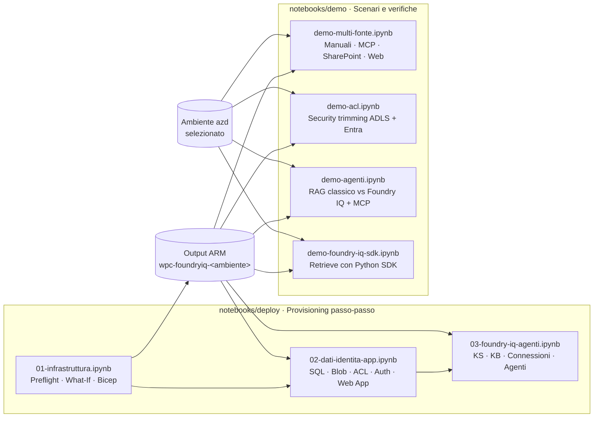

# Notebook Jupyter di deploy e demo

I notebook in questa cartella permettono di eseguire passo per passo il **deployment dell'ambiente Azure**, i **tre scenari dimostrativi** e una query con il Python SDK direttamente in VS Code o Jupyter.

Per una sessione con connettività incerta sono disponibili [copione, screenshot aggiornati e tre video MP4 offline](../docs/demo-guide.md). I video mostrano query reali della chat sullo stesso corpus sintetico; non sostituiscono le verifiche dei notebook né rappresentano l'esito di utenti o ambienti diversi.



## Prerequisiti

- **Azure CLI** autenticata sul tenant di destinazione (`az login --tenant <tenant-id>`).
- **Azure Developer CLI (`azd`)** per leggere l'ambiente selezionato nei notebook demo o precompilare opzionalmente quelli di deploy; non è richiesta scegliendo configurazione manuale e output ARM.
- **Python 3.10+** con kernel Jupyter registrato e pacchetti di [requirements.txt](requirements.txt).
- **Node.js 20.19+ / 22.12+ e npm** (richiesti da `02-dati-identita-app.ipynb` per compilare il frontend React/TypeScript di [webapp-chat](../webapp-chat/README.md)).
- Sottoscrizione Azure con quota per i modelli e permessi di provisioning e assegnazione ruoli (vedi [prerequisiti infrastruttura](../infra/README.md#prerequisiti)).

Creazione dell'ambiente virtuale dalla root del repository:

```powershell
python -m venv .venv
.\.venv\Scripts\python.exe -m pip install -r .\requirements.txt -r .\notebooks\requirements.txt
```

Apri i notebook in VS Code (estensioni **Python** e **Jupyter**) e seleziona l'interprete `.venv`.

## Caricamento opzionale delle variabili azd

[scripts/notebook_env.py](../scripts/notebook_env.py) legge `azd env get-values --output json --no-prompt` dalla root del repository, anche quando il kernel parte da `notebooks/deploy` o `notebooks/demo`. Non cambia l'ambiente azd selezionato e non esegue login, provisioning o deployment.

Nei **tre notebook di deploy**, imposta nella prima cella:

```python
LOAD_AZD_ENV = True
AZD_ENVIRONMENT_NAME = ""  # ambiente selezionato; oppure "nome-ambiente"
```

Il caricamento precompila `SUBSCRIPTION_ID`, `ENVIRONMENT_NAME` e `DEPLOYMENT_NAME` (`AZURE_DEPLOYMENT_NAME`, se disponibile, altrimenti `wpc-foundryiq-<ambiente>`). Nel notebook 01 precompila anche `LOCATION` e `RESOURCE_GROUP_NAME`; nel 03 i nomi delle KB e `SHAREPOINT_POLICIES_URL`. Puoi modificare le assegnazioni nella stessa cella per sovrascrivere questi valori. `BICEP_PARAMETERS` e i flag `RUN_*` restano espliciti: **il caricamento non avvia il deploy**. Con `LOAD_AZD_ENV = False` (default), azd non viene chiamato e restano i valori manuali; i notebook 02 e 03 continuano a leggere gli endpoint dagli output ARM. Per un deployment creato da azd indica il suo nome ARM effettivo in `DEPLOYMENT_NAME`, se diverso da quello calcolato.

I **quattro notebook demo/test** usano lo stesso helper automaticamente con `CONFIG_SOURCE = "azd"`; con `"arm"` non leggono azd.

L'helper è riutilizzabile da una cella di altri notebook nel repository:

```python
import sys
from pathlib import Path

root = next(p for p in (Path.cwd(), *Path.cwd().parents) if (p / "azure.yaml").is_file())
sys.path.insert(0, str(root / "scripts"))
from notebook_env import load_azd_env

values = load_azd_env("nome-ambiente", root=root)  # ometti il nome per l'ambiente selezionato
```

`load_azd_env` restituisce i valori effettivi e li inserisce in `os.environ` **nel processo del kernel**, senza stamparli o scrivere file `.env`. Di default conserva le variabili già presenti; `override=True` dà precedenza ai valori azd, come nei sette notebook. `read_azd_values` legge gli stessi valori senza modificare `os.environ`. Le variabili non presenti nell'ambiente azd non sono aggiunte né cancellate; i notebook usano il dizionario appena letto, non eventuali valori residui del kernel.

Sono ammesse solo le impostazioni non segrete elencate in `AZD_KEYS` (identità dell'ambiente, endpoint, nomi KB, ID gruppi ACL e URL delle policy). Chiavi, token, connection string e variabili estranee sono escluse. Se azd manca, l'ambiente non è disponibile o i valori non sono validi, il caricamento genera un errore esplicito senza ripiegare silenziosamente su un altro ambiente.

## Sequenza di deploy (`notebooks/deploy/`)

Esegui i tre notebook nell'ordine mantenendo lo stesso `ENVIRONMENT_NAME` (default `wpc-demo`). Ogni notebook legge endpoint, nomi risorse e identità direttamente dagli output del deployment ARM di sottoscrizione `wpc-foundryiq-<ENVIRONMENT_NAME>`, senza file di stato locali.

| Notebook | Responsabilità principali | Flag principali |
|---|---|---|
| [01-infrastruttura.ipynb](deploy/01-infrastruttura.ipynb) | Verifica utente connesso e quote modelli, genera o riusa `mcpApiKey`, recupera l'eventuale `chatAuthClientId`, esegue `what-if` e distribuisce [main.bicep](../infra/main.bicep). | `RUN_WHAT_IF=True`, `RUN_DEPLOY=False` (imposta `True` per creare le risorse) |
| [02-dati-identita-app.ipynb](deploy/02-dati-identita-app.ipynb) | Popola SQL (se pubblico), carica i manuali su Blob, crea i gruppi Entra *Tecnici* e *Direzione* e applica le ACL POSIX su ADLS Gen2, configura Easy Auth con federated credential, compila il frontend React/Vite, pubblica `mcp-ricambi` e `webapp-chat` e verifica `/healthz` e `tools/list`. | Flag per singola sezione (`RUN_SQL_SEED`, `RUN_UPLOAD_MANUALS`, `RUN_ACL_SETUP`, `RUN_CHAT_AUTH`, `RUN_APP_DEPLOY`) |
| [03-foundry-iq-agenti.ipynb](deploy/03-foundry-iq-agenti.ipynb) | Opzionalmente prepara il sito SharePoint e carica le policy PDF nelle cartelle `policies/EN` e `policies/IT`, crea l'app di ingestion secretless per SharePoint indexed (permessi Graph applicativi con consenso admin e credenziale federata con l'identità di Search), crea le knowledge source (`machinespecs-ks`, `ricambi-magazzino-ks`, `policies-sharepoint-ks`, `policies-sharepoint-indexed-ks`, `bing-filtered-ks`, `acl-docs-ks`), le knowledge base (`wpc-foundryiq-kb`, `wpc-acl-kb`), le connessioni del progetto Foundry e pubblica gli agenti definiti in [agents](../agents/README.md). | `RUN_SHAREPOINT`, `RUN_SHAREPOINT_INDEXED`, `RUN_ACL_KB`, `RUN_AGENTS` |

## Notebook di demo e test (`notebooks/demo/`)

I notebook dimostrativi sono indipendenti tra loro: i primi tre corrispondono alle route dedicate della [chat web app](../webapp-chat/README.md), mentre l'esempio SDK interroga direttamente la KB. Nella prima cella scegli la fonte della configurazione:

- **Ambiente azd** (default): `CONFIG_SOURCE = "azd"` e `AZD_ENVIRONMENT_NAME = ""` usano l'ambiente selezionato nella root del repository; indica un nome in `AZD_ENVIRONMENT_NAME` per usarne un altro senza cambiare la selezione. Gli endpoint, i nomi delle knowledge base e gli ID dei gruppi ACL sono letti dall'ambiente quando disponibili.
- **Output ARM**: `CONFIG_SOURCE = "arm"` usa `DEPLOYMENT_NAME = "wpc-foundryiq-<ENVIRONMENT_NAME>"` oppure un nome personalizzato. È adatto agli ambienti creati con `notebooks/deploy/`; se gli ID dei gruppi non sono negli output, la demo ACL li cerca per nome o usa gli ID indicati in `GROUP_IDS`.

Per entrambe le fonti serve una sessione Azure CLI autenticata. `SUBSCRIPTION_ID` è opzionale; con azd, se specificato, deve coincidere con la subscription dell'ambiente. Il tenant della configurazione è verificato prima delle chiamate, senza cambiare la subscription predefinita della CLI. Per la demo ACL anche il tenant predefinito della CLI deve coincidere, perché `az ad` usa quel contesto.

| Notebook | Use case e verifiche | Route web corrispondente |
|---|---|---|
| [demo-multi-fonte.ipynb](demo/demo-multi-fonte.ipynb) | Verifica composizione di `wpc-foundryiq-kb`, interroga gli scenari multi-fonte, confronta le categorie di fonti osservate con quelle attese, ispeziona `activity` e riferimenti e sintetizza una risposta con citazioni `[n]`. | `/demo/multi-fonte` |
| [demo-acl.ipynb](demo/demo-acl.ipynb) | Legge in sola lettura l'appartenenza dell'utente ai gruppi *Tecnici* e *Direzione* e le ACL reali su ADLS Gen2, poi confronta la `retrieve` senza e con il token della sorgente in `x-ms-query-source-authorization`, senza modificare i gruppi. | `/demo/acl` |
| [demo-agenti.ipynb](demo/demo-agenti.ipynb) | Confronta `wpc-rag-classico-rapido`, `wpc-rag-classico-accurato` e `wpc-technician-assistant` sulle stesse domande misurando tool invocati, chiamate, citazioni, token e tempi, oltre a testare `wpc-magazzino-assistant` sul server MCP. | `/demo/agenti` |
| [demo-foundry-iq-sdk.ipynb](demo/demo-foundry-iq-sdk.ipynb) | Interroga una KB con `KnowledgeBaseRetrievalClient`, mostra contenuti, riferimenti e attività e supporta il token utente per ACL e SharePoint. | `/demo/multi-fonte`, `/demo/acl` |

Nell'esempio SDK, `KB_PROFILE` sceglie la KB multi-fonte o ACL; `QUERY_MODE = "auto"` usa rispettivamente `messages` o intenti semantici. Cambia la domanda quando scegli la KB ACL. Il client richiede la versione preview `azure-search-documents==12.2.0b1`; dopo l'installazione aggiorna o riavvia il kernel.

La demo multi-fonte mostra il modello configurato nella knowledge base (ad esempio `gpt-5.2` nell'ambiente corrente); la sintesi opzionale usa invece il deployment chat `FOUNDRYIQ_DEMO_CHAT_DEPLOYMENT`, disattivabile con `RUN_SYNTHESIS = False`.

Le interrogazioni multi-fonte, anche dal notebook SDK, e degli agenti possono attivare il server MCP: con `SQL_AUTO_SEED=true`, alla prima lettura il servizio può creare o ricaricare il catalogo SQL se i dati di esempio sono cambiati. Vedi la [configurazione MCP](../mcp-ricambi/README.md).

Nei primi tre notebook ogni controllo registra un esito strutturato (`PASS`, `WARN`, `FAIL`, `SKIP`) e produce una tabella finale di riepilogo. Nella demo ACL l'assenza di un documento è segnalata come `WARN` quando non è autorizzato: da sola non dimostra che il filtro ACL ne abbia impedito la restituzione. Dopo modifiche alle appartenenze attendi la propagazione e, se necessario, ottieni un nuovo token.

## Sicurezza e pulizia dei notebook

- Nessun token, chiave API o segreto viene stampato o salvato su disco: `MCP_API_KEY` viene letta in memoria dalle impostazioni dell'App Service solo quando necessario.
- Salva e committa sempre i notebook **senza output** delle celle (`Clear All Outputs`), come verificato dalla suite di test `scripts/tests/test_notebooks.py`:

```powershell
python -m pytest scripts/tests/test_notebooks.py -q
```

- I notebook nella root del repository ([acl-demo.ipynb](../acl-demo.ipynb), [new-agent-deployment.ipynb](../new-agent-deployment.ipynb)) sono mantenuti come esempi legacy singoli.
