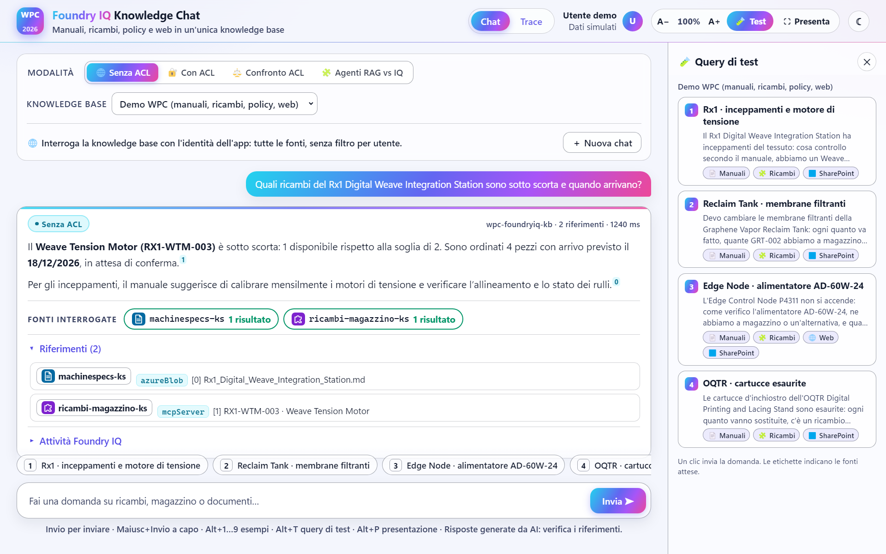
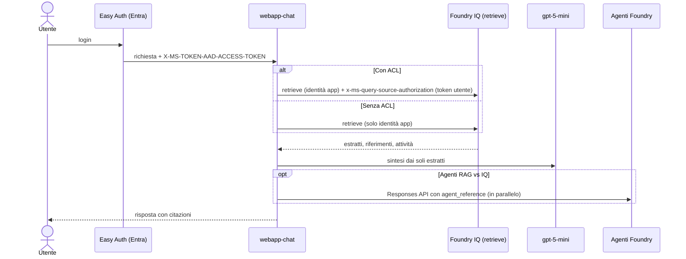

# Chat web app Foundry IQ

Applicazione web (FastAPI + HTML/JS statico) per interrogare le knowledge base Foundry IQ della demo e confrontare le risposte **con** e **senza** ACL.


| Knowledge base | Contenuto | Cosa osservare |
|---|---|---|
| `wpc-foundryiq-kb` | Manuali (Blob), magazzino (MCP), policy SharePoint opzionali, web Bing filtrato | Senza ACL possono rispondere Blob, MCP e web; SharePoint richiede l'identità dell'utente. |
| `wpc-acl-kb` | Documenti ADLS Gen2 con ACL per gruppo | Senza ACL nessun documento; con ACL solo le cartelle dei gruppi dell'utente. |

Modalità della chat (selettore in alto; una riga sotto descrive la modalità attiva):

- **Senza ACL** (predefinita): la chiamata usa solo l'identità della web app.
- **Con ACL**: la chiamata `retrieve` inoltra il token Search dell'utente nell'header `x-ms-query-source-authorization`, quindi Foundry IQ filtra i documenti in base ai suoi permessi.
- **Confronto ACL**: esegue le due chiamate in parallelo e mostra i risultati in due colonne.
- **Agenti RAG vs IQ**: invia la stessa domanda, in parallelo, ai due agenti RAG classici (`wpc-rag-classico-rapido`, `wpc-rag-classico-accurato`) e all'agente Foundry IQ (`wpc-technician-assistant`). Ogni colonna mostra risposta, tool chiamati, citazioni, tempi e token, e ogni agente mantiene la propria conversazione. Gli agenti girano con l'identità del progetto, quindi in questa modalità le ACL utente non si applicano; la riga descrittiva ricorda che SharePoint, senza identità utente, di solito non restituisce risultati. Il selettore della knowledge base è nascosto in questa modalità.

Per aprire la chat direttamente in una modalità usa il parametro `?mode=noacl|acl|compare|agents` (per esempio `/?mode=agents`). Come leggere il confronto: [agents](../agents/README.md#come-leggere-il-confronto).

Nelle modalità **Senza ACL**, **Con ACL** e **Confronto ACL**, la striscia **Fonti interrogate** mostra le knowledge source indicate nell'attività di Foundry IQ, con nome, icona del tipo e numero di risultati. Le fonti senza risultati sono tratteggiate, quelle in errore sono rosse; il dettaglio è nel tooltip. Ogni riferimento mostra anche il nome e l'icona della sua knowledge source quando `activitySource` lo collega a un'attività con nome; altrimenti è indicato che la fonte non è disponibile. Il nome della source è il testo alternativo e il tooltip dell'icona. Sotto si trova l'attività Foundry IQ (pianificazione delle query e sorgenti interrogate). La risposta finale è sintetizzata dal deployment `gpt-5-mini` usando solo i contenuti estratti.

[](../docs/images/chat-fonti.png)

*Clic sull'immagine per ingrandirla. Risposta e dati simulati nell'interfaccia reale, senza chiamate ad Azure.*

Nel confronto **Agenti RAG vs IQ**, l'output MCP dell'agente non espone necessariamente l'attività e i riferimenti della `retrieve`: se i nomi delle knowledge source non sono disponibili, la scheda lo indica senza dedurli dai tool o dalle citazioni.

L'interfaccia usa il tema WPC 2026: chiaro di default, con un pulsante nell'header per passare al tema scuro. La scelta resta salvata nel browser.

Per provarla: apri l'URL restituito da `azd env get-value CHAT_APP_URL`, accedi con l'utente demo, seleziona `wpc-acl-kb` in modalità **Confronto ACL** e chiedi un argomento dei documenti in [data/acl](../data/acl/): la colonna senza ACL resta vuota, quella con ACL mostra solo le cartelle dei tuoi gruppi.

### Utenti per il test ACL

Accedi con utenti del tenant appartenenti ai gruppi seguenti e seleziona **Demo ACL** e **Con ACL** oppure **Confronto ACL**:

| Appartenenza | Procedura ricambi | Modalità service | Accordi fornitori |
|---|---|---|---|
| Solo `WPC FoundryIQ ACL - Tecnici` | ✓ | ✓ | — |
| Solo `WPC FoundryIQ ACL - Direzione` | ✓ | — | ✓ |
| Entrambi i gruppi | ✓ | ✓ | ✓ |
| Nessuno dei due gruppi | — | — | — |

Lo script di setup aggiunge l'utente che lo esegue a *Tecnici*; non crea utenti né aggiunge membri a *Direzione*. Usa un secondo utente per il confronto o modifica temporaneamente l'appartenenza come mostrato nel [notebook ACL](../acl-demo.ipynb). Per cambiare utente nella web app usa una sessione privata o esci dall'accesso Microsoft. L'appartenenza ai gruppi può richiedere alcuni minuti per propagarsi; le etichette nel pannello indicano le ACL attese, non verificano l'identità corrente. In modalità **Senza ACL** il token utente non viene inoltrato e la KB ACL non restituisce documenti.

[](../docs/images/chat-acl.png)

*Clic sull'immagine per ingrandirla. Confronto illustrativo con risposte e identità simulate; i gruppi visualizzati sono quelli attesi, non una verifica dell'utente.*

## Architettura



- **App Service** (stesso piano B1 del server MCP) con **autenticazione App Service (Easy Auth)** e Microsoft Entra ID. Nessun client secret: l'app registration usa una *federated credential* con un'identità gestita assegnata dall'utente.
- Al login Easy Auth richiede un access token per `https://search.azure.com` e lo passa all'app nell'header `X-MS-TOKEN-AAD-ACCESS-TOKEN`.
- L'identità gestita di sistema della web app autorizza le chiamate (`Search Index Data Reader` su Search, `Cognitive Services OpenAI User` e `Azure AI User` sulla risorsa Foundry; quest'ultimo serve a invocare gli agenti).

`azd up` crea tutto: modulo [webapp-chat.bicep](../infra/modules/webapp-chat.bicep), app registration e configurazione dell'autenticazione ([setup_chat_auth.ps1](../scripts/setup_chat_auth.ps1), nel `postprovision`), pubblicazione del codice. L'URL è in `azd env get-value CHAT_APP_URL`. Per aggiornare solo il codice: `azd deploy webapp-chat`.

L'accesso è fail-closed. Bicep abilita sempre l'autenticazione App Service: finché `setup_chat_auth.ps1` non va a buon fine, o se viene saltato con `SKIP_CHAT_AUTH_SETUP=true`, non c'è un provider di identità e l'app risponde 401 a tutto tranne `/healthz`. In più, su App Service l'app rifiuta le richieste (503) se l'autenticazione non è attiva (`WEBSITE_AUTH_ENABLED`) e quelle senza utente autenticato (401). Così gli header di identità non possono essere falsificati.

Al primo accesso può essere richiesto il consenso ai permessi (*Sign in and read user profile*, *Access Azure AI Search*) se l'hook non ha potuto concedere l'admin consent.

## Visualizzatore trace

La pagina `/trace` (link *Trace* nell'header) mostra in modo leggibile i messaggi di un agente Foundry, in particolare le risposte dei tool di Foundry IQ (`tool_call_response`) con marcatori `【n:m†source】` seguiti da JSON con `uid`, `blob_url` e `snippet`.

- **Input**: incolla il JSON, apri un file o trascinalo nella pagina. Sono accettati un singolo messaggio, un array, un oggetto con `messages`/`data`/`items` oppure JSON Lines.
- **Sorgenti**: per ogni sorgente mostra documento, pagina (decodificata dall'`uid`), link al blob e snippet in markdown (tabelle comprese).
- **Viste**: *Cronologia* (ordine dei messaggi) e *Per documento* (sorgenti raggruppate per file e ordinate per pagina), con filtro testuale ed evidenziazione, JSON grezzo, espandi/comprimi tutto.

L'analisi avviene solo nel browser: il trace non viene inviato al server.

[](../docs/images/trace-esempio.png)

*Clic sull'immagine per ingrandirla. Trace sintetico di esempio, con URL non reale.*

## Modalità presentazione

L'interfaccia è pensata per essere proiettata: tutte le dimensioni sono in `rem` e scalano con la larghezza dello schermo. Anche fuori dalla modalità presentazione l'interfaccia è ad alta visibilità: testo secondario sempre leggibile (almeno 0,85 rem), contrasto rinforzato su testi e bordi in tema chiaro e scuro, e focus da tastiera ben visibile.

| Comando | Effetto |
|---|---|
| **⛶ Presenta** o `Alt+P` | Testo più grande, contrasto maggiore, larghezza piena; nasconde note ed etichette secondarie. Attivabile anche da URL con `?stage=1` (`?stage=0` per uscire). |
| **A−** / **A+** o `Alt+-` / `Alt+=` | Zoom dell'interfaccia dall'80% al 160%; clic sulla percentuale o `Alt+0` per tornare al 100%. |
| `Alt+T` | Mostra o nasconde il pannello delle query di test. |
| `Alt+1` … `Alt+9` | Inserisce la domanda di esempio corrispondente. A chat vuota gli esempi sono schede con titolo breve; durante la conversazione diventano chip compatti sopra la casella. |
| ☀ / ☾ | Tema chiaro di default o tema scuro: la scelta resta salvata nel browser. |

Le scelte restano salvate nel browser. Durante l'attesa ogni risposta mostra un timer, e al termine la pagina scorre all'inizio della domanda così il pubblico legge la risposta dall'alto. Per la sala usa anche `F11` (schermo intero).

## Query di prova multi-fonte

Queste domande richiedono più knowledge source della KB demo; la striscia *Fonti interrogate* mostra quali sono state usate. Le prime quattro sono gli esempi della home (`Alt+1` … `Alt+4`).

Tutte le query sono anche nel pannello **🧪 Query di test** a destra della chat (pulsante *Test* nell'intestazione o `Alt+T`): ogni voce mostra le fonti attese e, per gli esempi ACL, i gruppi attesi (*Tecnici*, *Direzione* o entrambi); un clic invia la domanda e le query già eseguite sono segnate con ✓. Il pannello segue la knowledge base selezionata ed è definito in `KNOWLEDGE_BASES` di [app.py](app.py) (`examples` + `extra_tests`).

| # | Domanda | Fonti attese |
|---|---|---|
| 1 | Il Rx1 Digital Weave Integration Station ha inceppamenti del tessuto: cosa controllo secondo il manuale, abbiamo un Weave Tension Motor disponibile e le policy dicono di ripararlo o sostituirlo? | Manuali, Ricambi (RX1-WTM-003 sotto scorta; ordine aperto senza alternativa associata), SharePoint (*Repair vs Replace*) |
| 2 | Devo cambiare le membrane filtranti della Graphene Vapor Reclaim Tank: ogni quanto va fatto, quante GRT-002 abbiamo a magazzino e come vanno smaltite quelle esauste? | Manuali (sostituzione settimanale), Ricambi, SharePoint (*Environmental and Waste Disposal*) |
| 3 | L'Edge Control Node P4311 non si accende: come verifico l'alimentatore AD-60W-24, ne abbiamo a magazzino o un'alternativa, e quali modelli equivalenti vendono i distributori online? | Manuali (tensione ≥ 22,5 V), Ricambi (AD-60W-24 sotto scorta), Bing, SharePoint (*Edge Equipment Guidelines*) |
| 4 | Le cartucce d'inchiostro dell'OQTR Digital Printing and Lacing Stand sono esaurite: ogni quanto vanno sostituite, c'è un ricambio alternativo disponibile e come segnalo il fermo al responsabile? | Manuali (sostituzione settimanale), Ricambi (OQTR-IC-004 a zero), SharePoint (*Communication Guidelines*) |
| 5 | Per la Cutting Blade Assembly CGC-001 del Contoso Robotic Garment Cut-Sew: frequenza di manutenzione, disponibilità e alternative, e regole di sicurezza nel maneggiarla. | Manuali, Ricambi, SharePoint (*Safety Protocols*, *Equipment Handling*) |
| 6 | Quali ricambi ad alta criticità sono sotto scorta e, per quelli della Delta Nano Circuit Board 3D Printer, cosa prevede il manuale per la manutenzione? | Ricambi (`low_stock_report`), Manuali |
| 7 | Il Print Bed Heater DS-PBH-004 ha 45 giorni di lead time: ci sono alternative a magazzino o prodotti equivalenti sui cataloghi dei distributori? | Ricambi, Bing |

Senza SharePoint configurato le domande 1–5 usano solo manuali, ricambi e Bing. Il piano di query lo decide il modello, quindi una fonte attesa può a volte restare vuota (chip tratteggiato): riformula citando esplicitamente il dettaglio mancante.

## Esecuzione locale

L'app legge la configurazione dall'ambiente azd oppure dalle variabili di sessione e usa l'identità di Azure CLI sia per l'app sia come utente (modalità con ACL). L'utente deve avere i ruoli *Search Index Data Reader* sul servizio Search e *Cognitive Services OpenAI User* sulla risorsa Foundry (già assegnati all'utente demo dal provisioning).

```powershell
az login --tenant <tenant-id>
# Solo dopo un deployment senza azd, dalla root del repository:
# ./scripts/load_env.ps1 -EnvironmentName wpc-foundryiq -NoAzd
cd webapp-chat
..\.venv\Scripts\python.exe -m pip install -r requirements.txt
..\.venv\Scripts\python.exe -m uvicorn app:app --reload
```

Apri <http://127.0.0.1:8000>. Il parametro `?kb=acl` preseleziona la knowledge base ACL.

Test:

```powershell
cd webapp-chat
..\.venv\Scripts\python.exe -m pip install pytest httpx
..\.venv\Scripts\python.exe -m pytest -q
```

## Variabili

| Variabile | Default | Descrizione |
|---|---|---|
| `FOUNDRYIQ_DEMO_SEARCH_ENDPOINT` | da azd | Endpoint del servizio Azure AI Search. |
| `FOUNDRYIQ_DEMO_OPENAI_ENDPOINT` | da azd | Endpoint OpenAI della risorsa Foundry. |
| `FOUNDRYIQ_DEMO_CHAT_DEPLOYMENT` | `gpt-5-mini` | Deployment usato per sintetizzare la risposta. |
| `FOUNDRYIQ_DEMO_KB_NAME` / `FOUNDRYIQ_ACL_KB_NAME` | `wpc-foundryiq-kb` / `wpc-acl-kb` | Knowledge base interrogate. |
| `FOUNDRYIQ_SEARCH_API_VERSION` | `2026-11-01-preview` | Versione API di Foundry IQ. |
| `FOUNDRYIQ_DEMO_PROJECT_ENDPOINT` | da azd | Endpoint del progetto Foundry per la modalità Agenti RAG vs IQ. |

## Note

- Le modifiche ai gruppi Entra si riflettono sul token solo dopo un nuovo login (logout da `/.auth/logout`).
- In modalità con ACL l'app rifiuta token non emessi per Azure AI Search e, se il token sta per scadere, la UI lo rinnova con `/.auth/refresh`.
