# Chat web app · Foundry IQ Knowledge Studio

Applicazione web (**FastAPI + React 19 / TypeScript con Vite**) in stile Fluent AI moderno per interrogare le knowledge base Foundry IQ della demo, confrontare le risposte **con** e **senza** ACL, confrontare **agenti RAG classico vs Foundry IQ** e ispezionare **architettura, infografiche e Trace**.

Per presentarla: [copione e video offline delle tre demo](../docs/demo-guide.md). Gli screenshot di questa guida provengono dall'interfaccia corrente, collegata ai servizi Azure tramite Azure CLI: i risultati sono live, il corpus è sintetico e i dati personali sono oscurati. L'acquisizione locale non verifica Easy Auth o l'identità gestita della Web App.

[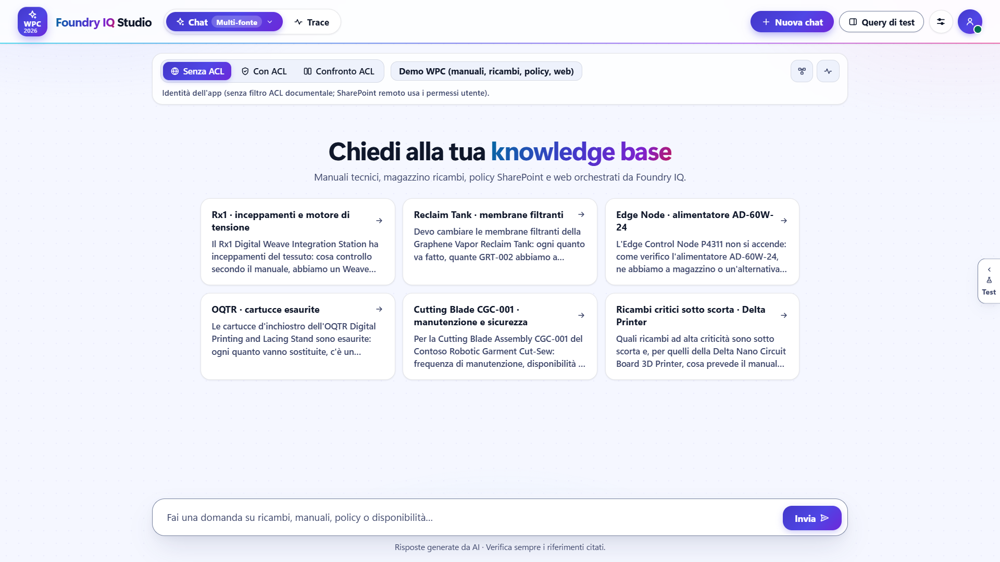](../docs/images/chat-home.png)

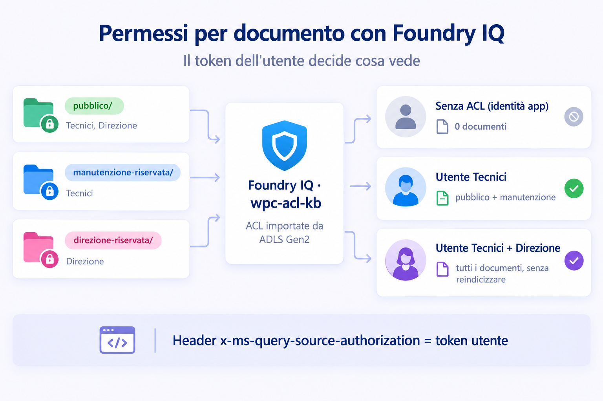

| Knowledge base | Contenuto | Cosa osservare |
|---|---|---|
| `wpc-foundryiq-kb` | Manuali (Blob), magazzino (MCP), policy SharePoint opzionali, web Bing filtrato | Senza ACL possono rispondere Blob, MCP e web; SharePoint richiede l'identità dell'utente. |
| `wpc-acl-kb` | Documenti ADLS Gen2 con ACL per gruppo | Senza ACL nessun documento; con ACL solo le cartelle dei gruppi dell'utente. |

Modalità della chat (selettore in alto; una riga sotto descrive la modalità attiva):

- **Senza ACL** (predefinita): la chiamata usa solo l'identità della web app.
- **Con ACL**: la chiamata `retrieve` inoltra il token Search dell'utente nell'header `x-ms-query-source-authorization`, quindi Foundry IQ filtra i documenti in base ai suoi permessi.
- **Confronto ACL**: esegue le due chiamate in parallelo e mostra i risultati in due colonne.
- **Agenti RAG vs IQ**: invia la stessa domanda, in parallelo, ai due agenti RAG classici (`wpc-rag-classico-rapido`, `wpc-rag-classico-accurato`) e all'agente Foundry IQ (`wpc-technician-assistant`). Ogni colonna mostra risposta, tool chiamati, citazioni, tempi e token, e ogni agente mantiene la propria conversazione. Gli agenti girano con l'identità del progetto, quindi in questa modalità le ACL utente non si applicano; la riga descrittiva ricorda che SharePoint, senza identità utente, di solito non restituisce risultati. Il selettore della knowledge base è nascosto in questa modalità.

Per aprire la chat direttamente in una modalità usa il parametro `?mode=noacl|acl|compare|agents` (per esempio `/?mode=agents`). Come leggere il confronto: [agents](../agents/README.md#come-leggere-il-confronto).

Il menu principale nella top bar raccoglie **Chat** (con sottomenu a discesa per la panoramica e le singole demo) e **Trace** (`/trace`). Sul lato destro della top bar trovano posto il pulsante primario **＋ Nuova chat**, il selettore **Query di test** (che apre o nasconde la sidebar laterale, chiusa di default per lasciare spazio alla conversazione), il menu compatto di visualizzazione (tema, zoom e modalità presentazione) e, come primo elemento sul margine destro, l'**icona cliccabile dell'utente** che apre **Identità e sessione utente**. Ogni scenario ha un URL condivisibile:

| Percorso | Voce nel sottomenu Chat | Scenario |
|---|---|---|
| `/` | **Panoramica Chat** | Selettore libero di modalità, knowledge base o agenti. |
| `/demo/multi-fonte` | **Multi-fonte** | Knowledge base multi-fonte, inizialmente senza ACL. |
| `/demo/acl` | **ACL** | Knowledge base ACL, inizialmente in confronto con/senza ACL. |
| `/demo/agenti` | **Agenti RAG vs IQ** | Confronto parallelo tra gli agenti selezionati. |

Nelle prime due pagine si può cambiare modalità ACL, ma la knowledge base resta fissata allo scenario; nella terza sono selezionabili solo gli agenti. `?mode=noacl`, `?mode=acl` e `?mode=compare` possono impostare la modalità iniziale delle prime due pagine; parametri non compatibili e `?kb=` non cambiano lo scenario della route. La chat generale `/` e i suoi link esistenti restano disponibili. Aprire un'altra route o ricaricare la pagina avvia una nuova conversazione e azzera la trace corrente.

Nelle modalità **Senza ACL**, **Con ACL** e **Confronto ACL**, la striscia **Fonti interrogate** mostra le knowledge source indicate nell'attività di Foundry IQ, con nome, icona del tipo e numero di risultati. Le fonti senza risultati sono tratteggiate, quelle in errore sono rosse; il dettaglio è nel tooltip. Ogni riferimento mostra il nome e l'icona della sua knowledge source quando `activitySource` lo collega a un'attività non ambigua. Per una fonte `mcpServer` la scheda riporta tool, argomenti, conteggio, durata, date, stato, errori e avvisi disponibili nell'attività. Le attività MCP senza riferimenti compaiono separatamente sotto **Riferimenti**, senza diventare citazioni. Il conteggio della fonte è quello restituito da Foundry IQ dopo il reranking. La risposta finale è sintetizzata dal deployment `gpt-5-mini` usando solo i contenuti estratti.

Nelle risposte retrieve, `[0]` e `[ref_id:0]` collegano il riferimento con lo stesso ID nella propria scheda. Nel confronto agenti, le annotazioni con posizioni valide diventano pulsanti `[C1]`, mentre i riferimenti restituiti dal tool sono elencati separatamente: possono essere stati recuperati senza essere stati citati. Un `[ref_id:0]` si collega solo a un ID non ambiguo; un semplice `[0]` non viene associato automaticamente a un riferimento MCP, perché potrebbe indicare una citazione diversa.

I marcatori come `【6:3†source】` sono collegati solo quando lo stesso marcatore identifica esplicitamente un singolo riferimento nell'output del tool. In tutti gli altri casi restano visibili senza collegamenti ipotizzati; ID o marcatori duplicati non vengono associati. Attivando un collegamento si apre l'elenco della risposta e il focus passa alla scheda corretta. Titolo, fonte, tipo e link esterni sono mostrati quando disponibili; i percorsi storage restano testo. Citazioni senza posizione e riferimenti non esposti dal provider sono segnalati nell'elenco. Fino a tre schede sono visibili subito.

La definizione locale dell'agente Foundry IQ richiede di citare i `ref_id` effettivamente restituiti dal tool; l'istruzione si applica all'agente distribuito solo dopo un aggiornamento della sua definizione.

[](../docs/images/chat-fonti.png)

*Clic sull'immagine per ingrandirla. Risposta effettiva di una query Azure sul corpus sintetico; source vuote o in errore restano visibili. [Video multi-fonte](../docs/videos/demo-multi-fonte.mp4).*

[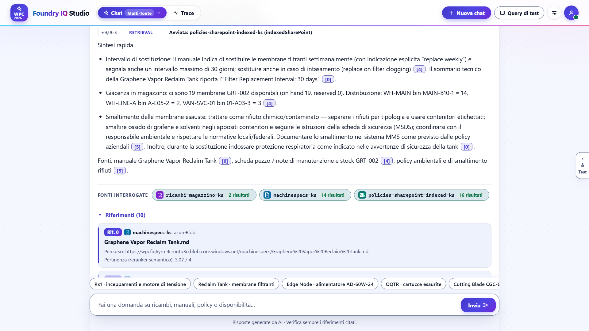](../docs/images/chat-fonti-dettaglio.png)

*Fotogramma della stessa registrazione: MCP ricambi, Blob e SharePoint indexed. Non dimostra l'uso della sorgente remota o di Bing in quella query.*

Nel confronto **Agenti RAG vs IQ**, i riferimenti restituiti da `knowledge_base_retrieve` mostrano la chiamata MCP dell'agente e, se presente nell'output, anche l'attività MCP interna della fonte. Le altre chiamate MCP, comprese quelle dirette al magazzino e quelle senza riferimenti, sono elencate separatamente. Una citazione non viene collegata a un tool per somiglianza del titolo; i dati che il provider non espone restano non disponibili. L'output grezzo completo dei tool non è incluso nelle schede o nella Trace corrente.

Ogni scheda del confronto separa **chiamate tool**, **tempo totale** (secondi, con millisecondi esatti sotto) e **token totali** in tre riquadri KPI affiancati con icone vettoriali. I token di **input** e **output** sono indicati separatamente insieme a una barra proporzionale; i numeri seguono la formattazione italiana. Il riepilogo **Tool invocati in questa risposta** raggruppa le chiamate osservate per tipo, server e nome, con conteggi ed errori: non rappresenta il numero di tool configurati nell'agente. **Dettaglio delle chiamate** mostra ogni chiamata numerata, stato, server e argomenti disponibili. I conteggi MCP sono mostrati solo se esplicitamente restituiti; i dati mancanti non diventano zero. La durata della singola chiamata è misurata dalla chat solo se lo stream ne ha mostrato inizio e fine.

[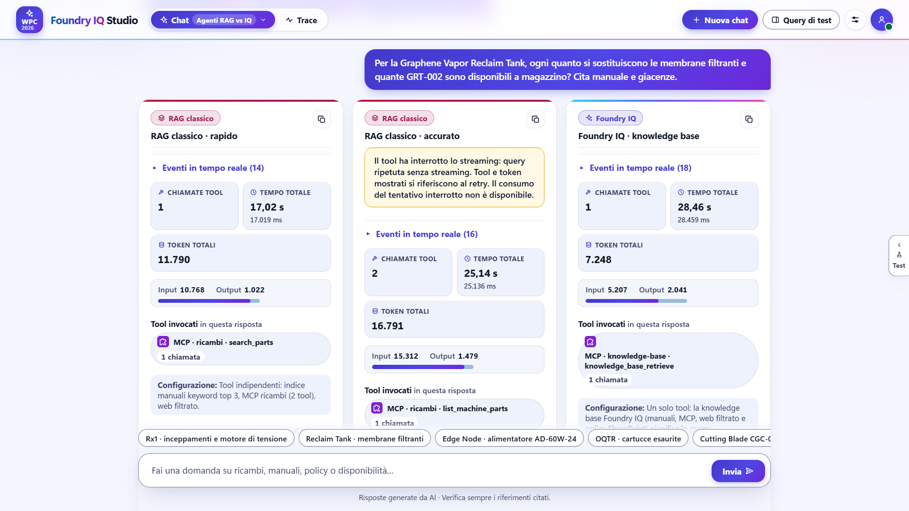](../docs/images/chat-agenti.png)

*Clic sull'immagine per ingrandirla. Tre risposte effettive sulla stessa domanda: RAG rapido, RAG accurato e Foundry IQ. Tempi e token sono quelli della sessione registrata, non un benchmark. [Video agenti](../docs/videos/demo-agenti.mp4).*

L'interfaccia usa il design system **Foundry IQ Knowledge Studio**: tema chiaro di default senza flash iniziale, con pulsante nell'header per passare al tema scuro (scelta salvata nel browser). A conversazione vuota l'hero presenta le pillole delle capacità attive e le **starter card Bento** sempre accessibili (`Alt+1…9`); ogni scheda risposta include un pulsante rapido **Copia risposta** e uno stato di caricamento animato con timer live. Superfici glassmorphic, schede e controlli distinguono le sezioni rispettando il contrasto WCAG AA; badge, fonti vuote ed errori hanno sempre etichette testuali oltre al colore. Le colonne del confronto si adattano allo spazio effettivamente disponibile tramite container query, anche con il pannello dei test aperto o il testo ingrandito fino al 160%.

### Profilo e gruppi dell'utente

Il pulsante dell'utente nell'header apre il profilo: nome, account, ID Entra, tenant, origine dell'autenticazione, disponibilità e scadenza del token Search. I gruppi vengono letti dai claim di Easy Auth / ID token (in locale dal token Azure CLI). All'apertura del profilo l'app rilegge i claim e cerca i nomi in Microsoft Graph **solo per gli Object ID presenti**, mostrando comunque gli ID; i token non vengono inviati al browser. Se la ricerca è incompleta o non disponibile, il profilo indica l'errore e conserva gli ID. Se nel frattempo cambia l'ID utente o tenant, chiede di ricaricare la pagina. I ruoli applicativi sono mostrati separatamente: non sono gruppi.

Un claim mancante è indicato come **non disponibile**, non come assenza di appartenenze. In caso di *group overage* l'elenco è segnalato come incompleto: l'app non cerca le altre appartenenze in Graph. Il token Search non è valido per Graph; la risoluzione dei nomi usa un token distinto e non modifica il controllo ACL.

[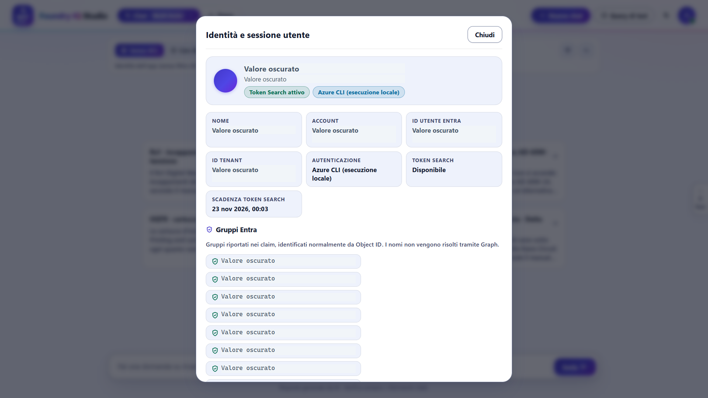](../docs/images/chat-profilo.png)

*Disponibilità del token e stato dei claim osservati nella sessione locale; nome, account e identificatori sono oscurati solo nell'acquisizione, senza modificare autenticazione o risposte.*

`scripts/setup_chat_auth.ps1` abilita `groupMembershipClaims=SecurityGroup` nell'app registration della chat. Per un'app già configurata riesegui lo script e fai logout/login per aggiornare l'ID token. Non assegna il permesso Graph descritto sotto. I claim mostrati sono informativi e possono non rappresentare tutte le appartenenze della directory.

Su App Service i nomi richiedono il permesso **applicativo** Microsoft Graph `Group.ReadBasic.All` sull'**identità gestita di sistema** della web app (non sull'identità assegnata dall'utente usata per il login). Il permesso consente la lettura delle proprietà di base di tutti i gruppi del tenant, anche se l'app interroga solo gli ID dei claim; richiede un amministratore e non viene concesso automaticamente. Un amministratore con i privilegi necessari può assegnarlo una volta, usando Azure CLI e i moduli PowerShell `Microsoft.Graph.Authentication` e `Microsoft.Graph.Applications`:

```powershell
$resourceGroup = '<resource-group-della-chat>'
$webAppName = '<nome-web-app-chat>'
$tenantId = az account show --query tenantId -o tsv
$managedId = az webapp identity show --resource-group $resourceGroup --name $webAppName --query principalId -o tsv
if (-not $tenantId -or -not $managedId) { throw 'Tenant o identità gestita di sistema non trovati.' }
Connect-MgGraph -TenantId $tenantId -Scopes 'AppRoleAssignment.ReadWrite.All', 'Application.Read.All'
$graph = Get-MgServicePrincipal -Filter "appId eq '00000003-0000-0000-c000-000000000000'" -Property Id,AppRoles
$role = @($graph.AppRoles | Where-Object { $_.Value -eq 'Group.ReadBasic.All' -and $_.AllowedMemberTypes -contains 'Application' })
if (-not $graph.Id -or $role.Count -ne 1) { throw 'Service principal o ruolo Microsoft Graph non trovato.' }
$existing = Get-MgServicePrincipalAppRoleAssignment -ServicePrincipalId $managedId -All |
  Where-Object { $_.ResourceId -eq $graph.Id -and $_.AppRoleId -eq $role[0].Id }
if (-not $existing) {
  New-MgServicePrincipalAppRoleAssignedTo -ServicePrincipalId $graph.Id -PrincipalId $managedId -ResourceId $graph.Id -AppRoleId $role[0].Id
}
```

La propagazione del ruolo può richiedere tempo per la cache dei token dell'identità gestita. In locale, invece, Graph usa l'identità di Azure CLI e i suoi **permessi delegati**: l'assegnazione alla managed identity non abilita automaticamente la risoluzione locale. Per la lettura dei gruppi, anche i permessi delegati e la visibilità dell'utente devono essere adeguati. Vedi [assegnazione dei ruoli a una managed identity](https://learn.microsoft.com/entra/identity/managed-identities-azure-resources/assign-app-role-managed-identity-powershell) e [lettura di un gruppo con Graph](https://learn.microsoft.com/graph/api/group-get?view=graph-rest-1.0).

### Infografiche di architettura e query

**Architettura e ACL**, nei controlli della chat, cambia diagramma per demo: mappa hub-and-spoke per le fonti della demo WPC, corsie separate per il security trimming ADLS della demo ACL e schede parallele per gli agenti selezionati. Ogni **Infografica del flusso e ACL** usa la stessa grammatica della demo: flusso a fonti con le sole source osservate, percorso di identità/ACL per la KB ACL oppure chiamate tool restituite dall'agente. Nel confronto ACL le schede restano separate per non confondere i risultati.

Le infografiche sono SVG vettoriali **16:9 (1600 × 900)** in stile Fluent: sfondo lavanda chiarissimo, corsie e schede arrotondate, ombre leggere e caratteri Segoe UI. **Scarica SVG 16:9** salva il diagramma corrente; verifica il contenuto prima di condividerlo. La descrizione testuale espandibile contiene i dettagli completi e le query delle attività restituite; su schermi piccoli è aperta automaticamente. Le finestre supportano tastiera, Escape e ripristino del focus.

Il flusso non inventa attività mancanti o decisioni ACL: il servizio non espone necessariamente i documenti esclusi, e **zero risultati non prova un diniego ACL**. La modalità senza ACL può comunque inoltrare il token per SharePoint remoto; gli agenti usano l'identità del progetto senza ACL del chiamante.

[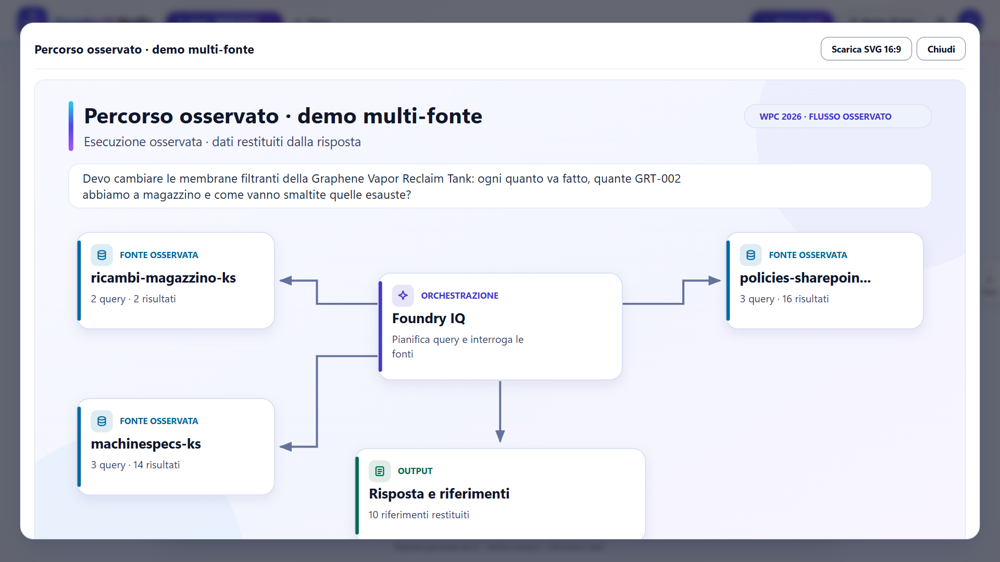](../docs/images/chat-infografica.png)

Per provarla: apri l'URL restituito da `azd env get-value CHAT_APP_URL`, accedi con l'utente demo, seleziona `wpc-acl-kb` in modalità **Confronto ACL** (oppure apri `/demo/acl`) e chiedi un argomento dei documenti in [data/acl](../data/acl/): la colonna senza ACL resta vuota, quella con ACL mostra solo le cartelle dei tuoi gruppi.

### Utenti per il test ACL

Accedi con utenti del tenant appartenenti ai gruppi seguenti e seleziona **Demo ACL** e **Con ACL** oppure **Confronto ACL**:

| Appartenenza | Procedura ricambi | Modalità service | Accordi fornitori |
|---|---|---|---|
| Solo `WPC FoundryIQ ACL - Tecnici` | ✓ | ✓ | — |
| Solo `WPC FoundryIQ ACL - Direzione` | ✓ | — | ✓ |
| Entrambi i gruppi | ✓ | ✓ | ✓ |
| Nessuno dei due gruppi | — | — | — |

Lo script di setup aggiunge l'utente che lo esegue a *Tecnici*; non crea utenti né aggiunge membri a *Direzione*. Puoi verificare il comportamento senza modificare i gruppi con il notebook [demo-acl.ipynb](../notebooks/demo/demo-acl.ipynb), usare un secondo utente del tenant oppure consultare l'esempio legacy [acl-demo.ipynb](../acl-demo.ipynb). Per cambiare utente nella web app usa una sessione privata o esci dall'accesso Microsoft. L'appartenenza ai gruppi può richiedere alcuni minuti per propagarsi; le etichette nel pannello indicano le ACL attese, non verificano l'identità corrente. In modalità **Senza ACL** il token utente non viene inoltrato e la KB ACL non restituisce documenti.

[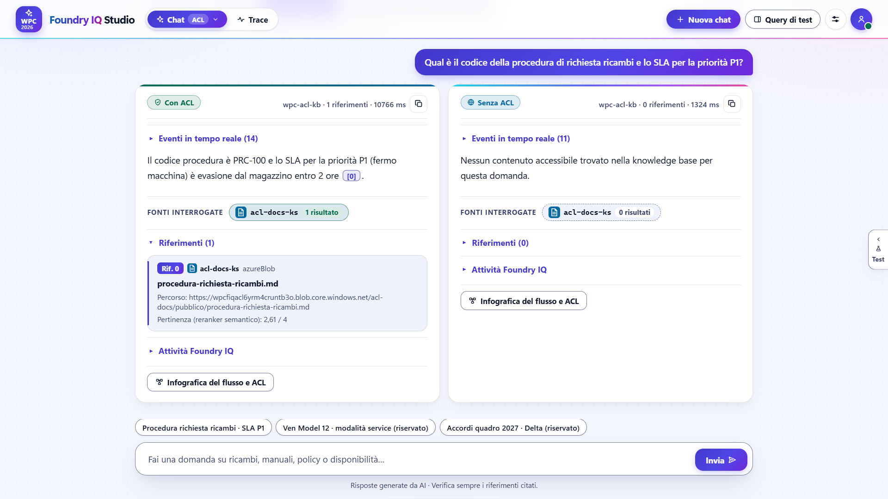](../docs/images/chat-acl.png)

*Clic sull'immagine per ingrandirla. Due retrieve reali sulla stessa domanda, con e senza token utente. I gruppi attesi non verificano l'utente; zero risultati non dimostra da solo un diniego ACL. [Video ACL](../docs/videos/demo-acl.mp4).*

## Architettura

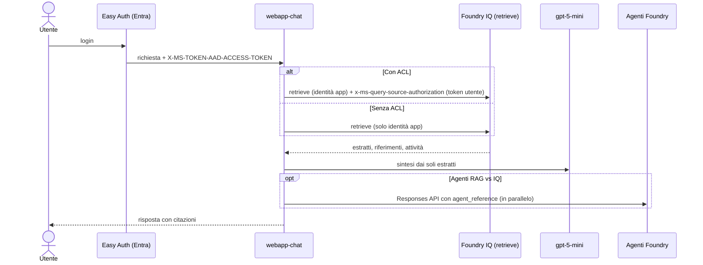

- **App Service** (stesso piano B1 del server MCP) con **autenticazione App Service (Easy Auth)** e Microsoft Entra ID. Nessun client secret: l'app registration usa una *federated credential* con un'identità gestita assegnata dall'utente.
- Al login Easy Auth richiede un access token per `https://search.azure.com` e lo passa all'app nell'header `X-MS-TOKEN-AAD-ACCESS-TOKEN`.
- L'identità gestita di sistema della web app autorizza le chiamate (`Search Index Data Reader` su Search, `Cognitive Services OpenAI User` e `Azure AI User` sulla risorsa Foundry; quest'ultimo serve a invocare gli agenti).

`azd up` crea tutto: modulo [webapp-chat.bicep](../infra/modules/webapp-chat.bicep), app registration e configurazione dell'autenticazione ([setup_chat_auth.ps1](../scripts/setup_chat_auth.ps1), nel `postprovision`), pubblicazione del codice. L'hook `prepackage` compila il frontend React con Node.js e npm prima di includerlo nel pacchetto; anche `scripts/deploy_noazd.ps1` esegue la build. L'URL è in `azd env get-value CHAT_APP_URL`. Per aggiornare solo il codice: `azd deploy webapp-chat`.

L'accesso è fail-closed. Bicep abilita sempre l'autenticazione App Service: finché `setup_chat_auth.ps1` non va a buon fine, o se viene saltato con `SKIP_CHAT_AUTH_SETUP=true`, non c'è un provider di identità e l'app risponde 401 a tutto tranne `/healthz`. In più, su App Service l'app rifiuta le richieste (503) se l'autenticazione non è attiva (`WEBSITE_AUTH_ENABLED`) e quelle senza utente autenticato (401). Così gli header di identità non possono essere falsificati.

Al primo accesso può essere richiesto il consenso ai permessi (*Sign in and read user profile*, *Access Azure AI Search*) se l'hook non ha potuto concedere l'admin consent.

## Visualizzatore trace

La pagina `/trace` (link *Trace* nell'header) mostra in modo leggibile i messaggi di un agente Foundry, in particolare le risposte dei tool di Foundry IQ (`tool_call_response`) con marcatori `【n:m†source】` seguiti da JSON con `uid`, `blob_url` e `snippet`.

- **Input**: incolla il JSON, apri un file o trascinalo nella pagina. Sono accettati un singolo messaggio, un array, un oggetto con `messages`/`data`/`items` oppure JSON Lines.
- **Sorgenti**: per ogni sorgente mostra documento, pagina (decodificata dall'`uid`), link al blob e snippet in markdown (tabelle comprese).
- **Viste**: *Cronologia* (ordine dei messaggi) e *Per documento* (sorgenti raggruppate per file e ordinate per pagina), con filtro testuale ed evidenziazione, JSON grezzo, espandi/comprimi tutto.
- **Grafico temporale** nella vista Cronologia: barre sulla stessa scala per ogni richiesta, chiamata tool, attività Foundry IQ e fase disponibili, anche nella Trace corrente. Le barre sovrapposte mostrano attività concorrenti; i tempi non disponibili restano espliciti.

L'analisi avviene solo nel browser: il trace non viene inviato al server.

Durante l'elaborazione, nelle modalità retrieve (**Senza ACL**, **Con ACL**, **Confronto ACL**) ogni risposta mostra gli **Eventi in tempo reale** in una console affiancata al testo, con tempi, fasi e dettagli aggiornati dallo stream. Nei riquadri stretti la console passa sotto il testo. Lo scorrimento segue i nuovi eventi finché non si scorre verso l'alto per leggere quelli precedenti. Al termine, anche in caso di errore, il riepilogo eventi resta espandibile dopo la risposta e prima dei riferimenti. Nel confronto **Agenti RAG vs IQ** gli eventi restano in cima alla scheda, sopra KPI e risposta.

**Visualizza trace corrente**, nei controlli della Chat, apre una finestra di dialogo nella stessa pagina, senza nuove schede. La trace si aggiorna mentre arrivano le risposte, comprese richieste in corso ed errori; confronti ACL e agenti restano distinti e nell'ordine di avvio. La dialog offre le stesse viste e gli stessi filtri della pagina `/trace`, oltre al JSON della conversazione corrente. **Nuova chat**, cambio modalità/KB e ricaricamento della Chat azzerano la raccolta. Non recupera retroattivamente risposte precedenti al caricamento del codice.

Sono mostrati risposta, attività retrieval, tool/stati osservati, riferimenti/citazioni, tempo totale, conteggi token e metadati ACL disponibili; non è la trace interna completa di Foundry. Non si inventano output tool, snippet o decisioni ACL per documento. La sezione **Metadati della risposta** presenta in tabelle leggibili (con il JSON espandibile):

- **tappe** misurate dall'app sugli eventi di streaming: primo evento, primo tool, retrieval completato, primo token e totale;
- **fasi** (agente, retrieval, tool, generazione) con inizio, fine, durata ed eventi;
- **attività Foundry IQ** per fonte, con query, risultati, millisecondi e token restituiti dal servizio;
- tutti gli **eventi in tempo reale**, comprese query e argomenti dei tool (contrassegnati come *query/argomenti*).

Il grafico usa i tempi relativi misurati dall'app alla ricezione degli eventi di avvio e completamento, non gli span interni del servizio. Le fasi rappresentano l'intervallo tra il primo e l'ultimo evento osservato, non la durata esatta del modello; se manca un evento, la durata non viene inventata. Durante lo streaming la barra della richiesta arriva all'ultimo evento osservato; file senza tempi mostrano i dati come non disponibili.

Ogni `tool_call` include argomenti e durata quando l'avvio e il completamento sono stati osservati nello stream; i riferimenti includono anche i metadati MCP e gli argomenti disponibili. Configurazione utente, header e claim non sono inclusi; credenziali, token riconoscibili e query/fragment degli URL sono oscurati anche negli argomenti strutturati. Nessun local/session storage: chiudere la dialog conserva la trace nella chat, mentre chiudere o ricaricare la pagina elimina i dati. La pagina `/trace` resta disponibile per analizzare trace incollate o caricate manualmente. Prima di condividere qualsiasi trace, verifica i contenuti di domande, query e risposte.

[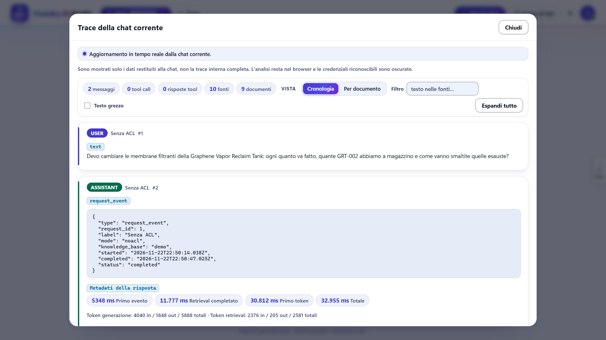](../docs/images/trace-esempio.png)

*Clic sull'immagine per ingrandirla. Trace della query multi-fonte acquisita durante la registrazione: solo dati effettivamente esposti dalla chat, con le credenziali riconoscibili oscurate.*

[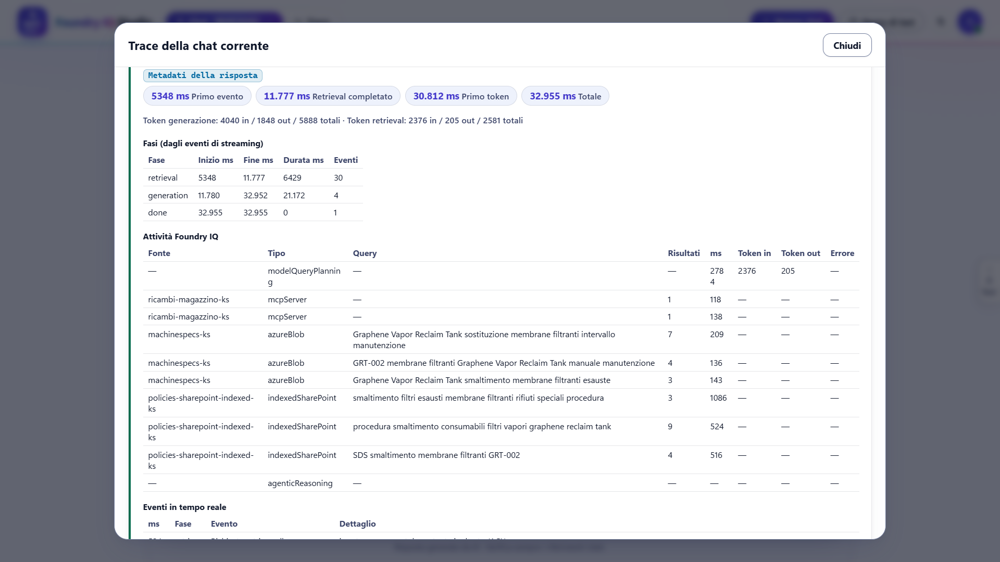](../docs/images/trace-metadati.png)

*Metadati della stessa risposta: tappe e fasi misurate sullo stream, attività per knowledge source con query, risultati, millisecondi e token. Per gli agenti vedi [la Trace con argomenti e durata dei tool](../docs/images/trace-metadati-agenti.png).*

## Modalità presentazione

L'interfaccia è pensata per essere proiettata: tutte le dimensioni sono in `rem` e scalano con la larghezza dello schermo. Anche fuori dalla modalità presentazione l'interfaccia è ad alta visibilità: testo secondario sempre leggibile (almeno 0,85 rem), contrasto rinforzato su testi e bordi in tema chiaro e scuro, e focus da tastiera ben visibile.

| Comando | Effetto |
|---|---|
| **Modalità Presentazione** (menu opzioni in alto a destra) o `Alt+P` | Testo più grande, contrasto maggiore, larghezza piena; nasconde note secondarie. Attivabile anche da URL con `?stage=1` (`?stage=0` per uscire). |
| **A−** / **A+** (menu opzioni) o `Alt+-` / `Alt+=` | Zoom dell'interfaccia dall'80% al 160%; clic sulla percentuale o `Alt+0` per tornare al 100%. |
| **Query di test** / linguetta laterale `‹ Test` / **Comprimi ›** o `Alt+T` | Espande o comprime con animazione la sidebar laterale delle query di test (sempre nascosta di default all'apertura). |
| `Alt+1` … `Alt+9` | Inserisce la domanda di esempio corrispondente. A chat vuota gli esempi sono starter card nell'hero; durante la conversazione diventano chip rapidi sopra il composer. |
| **Tema scuro / chiaro** (menu opzioni) | Tema chiaro di default o tema scuro: la scelta resta salvata nel browser. |

Le scelte restano salvate nel browser. Durante l'attesa ogni risposta mostra un timer, e al termine la pagina scorre all'inizio della domanda così il pubblico legge la risposta dall'alto. Le animazioni rispettano la preferenza di movimento ridotto; focus, etichette dei campi e link di salto facilitano l'uso da tastiera. Per la sala usa anche `F11` (schermo intero).

### Streaming delle risposte e della telemetria

La chat richiede SSE tramite `stream: true` su `/api/chat` e `/api/agent-chat`. Senza questo campo gli endpoint conservano la risposta JSON, usata dai notebook e dagli altri client. Lo streaming vale anche per i confronti: ogni scheda e la Trace corrente si aggiornano indipendentemente. **Nuova chat** annulla le richieste del browser; risposte incomplete ed errori restano espliciti e non vengono inseriti nella cronologia come risposte riuscite.

Il [retrieve Foundry IQ](https://learn.microsoft.com/azure/search/agentic-retrieval-how-to-retrieve#stream-retrieve-results) usa `Accept: text/event-stream` con l'API `2026-11-01-preview`: gli eventi reali mostrano avvio e completamento delle attività, sorgenti, risultati, tempi e token quando disponibili. Il retrieve non emette testo token per token; la sintesi Azure OpenAI successiva lo fa. I token **retrieval Foundry IQ** e **generazione risposta** sono separati, senza stime o sommare due volte le attività. Il totale retrieval rappresenta solo le attività che espongono i token.

Gli agenti trasmettono testo e attività tool tramite lo stream della Responses API. Il tool della knowledge base non espone necessariamente le sue attività interne: non vengono inventate, e i token dell'agente non sono presentati come costo totale del retrieval.

Ogni scheda include **Eventi in tempo reale**, aperto durante la risposta e richiudibile al termine. La sequenza mostra, con l'istante relativo all'avvio:

- per Foundry IQ: richiesta retrieve e identità usata, `retrieval.started`, avvio e completamento di ogni attività (risultati, tempo e token), riferimenti risolti (`references.completed`), risultati parziali 206, riepilogo del retrieval, inizio della sintesi, primo token, token di generazione;
- per gli agenti: esecuzione avviata, tool MCP disponibili, ragionamento, inizio e fine di ogni chiamata tool, riferimenti restituiti da `knowledge_base_retrieve`, citazioni man mano che vengono annotate, riepilogo finale, eventuale retry ed errori.

Riferimenti e citazioni compaiono nella scheda appena arrivano; il risultato completato conserva anche i dati osservati nello stream quando mancano nella risposta finale, riconciliando le chiamate tramite ID. Sono mostrati solo eventi effettivamente ricevuti dal servizio. Query e argomenti dei tool sono visibili nella scheda e vengono copiati anche nella Trace corrente, con credenziali e query string degli URL oscurate. Nella scheda gli argomenti sono invece mostrati come restituiti e possono contenere dati riservati: controllali prima di condividere la schermata. Gli eventi `tool` e le attività Foundry IQ con ID includono, quando osservabili, `started_ms`, `completed_ms` e `duration_ms` misurati dall'app sullo stream.

[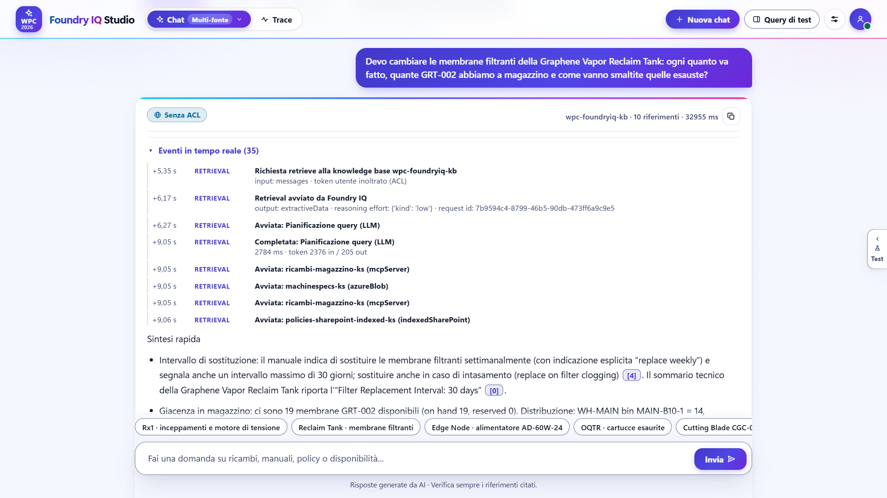](../docs/images/chat-timeline.png)

*Eventi in tempo reale registrati su Azure: richiesta retrieve, pianificazione query con token e avvio delle knowledge source. Per gli agenti vedi [la timeline del confronto](../docs/images/chat-timeline-agenti.png).*

Per **RAG classico accurato**, il provider può interrompere lo stream del tool Search con `A user error occurred while executing a tool call`. Solo per questo errore, e prima che sia arrivato testo, l'app esegue un unico retry senza streaming del risultato. Scheda e Trace mostrano l'avviso; la risposta arriva completa, senza simulare i token. Tool e token visualizzati appartengono al retry, mentre il consumo del primo tentativo non è disponibile. Il tempo totale include entrambi i tentativi. Gli altri errori, le interruzioni dopo l'arrivo di testo e gli eventuali errori del retry restano espliciti.

Lo stesso errore del tool può comparire anche nella chiamata senza streaming: il retry non garantisce il recupero e non modifica modello, tool o impostazioni di ricerca. Se fallisce, la scheda conserva l'avviso e mostra l'errore, mentre gli altri agenti continuano il confronto.

### Video offline e aggiornamento degli screenshot

Le registrazioni sono in [docs/videos](../docs/videos/), in formato MP4 H.264 1080p, senza audio e con indicazioni in italiano. Scaricale prima della presentazione; GitHub Pages contiene i player, ma senza rete serve il file locale. Il [copione](../docs/demo-guide.md) spiega prerequisiti, limiti osservabili e passaggio dal live al video.

Il companion script [capture_demo_media.py](../scripts/capture_demo_media.py) rigenera screenshot e tre video usando l'app avviata, un profilo browser isolato e richieste reali. Non simula gli endpoint né cambia gruppi/ACL; un errore della richiesta impedisce la pubblicazione degli asset. URL e canale browser sono parametrizzati, mentre dati personali e ID del profilo sono oscurati nelle acquisizioni. [Procedura completa](../docs/demo-guide.md#rigenerare-screenshot-e-registrazioni).

## Query di prova multi-fonte

Queste domande richiedono più knowledge source della KB demo; la striscia *Fonti interrogate* mostra quali sono state usate. Le prime sette sono gli esempi della home (`Alt+1` … `Alt+7`). L'ordine è condiviso dalle modalità retrieval e dal confronto agenti.

Tutte le query sono disponibili nella sidebar collassabile **Query di test** a destra della chat (sempre nascosta di default all'avvio; si espande dalla linguetta laterale `‹ Test` sul bordo destro, dal pulsante **Query di test** nella top bar o con `Alt+T`, e si richiude con **Comprimi ›**), dotata di contatore di completamento e barra di avanzamento: ogni voce mostra le fonti attese e, per gli esempi ACL, i gruppi attesi (*Tecnici*, *Direzione* o entrambi); un clic invia subito la domanda e le query già eseguite sono segnate con ✓. Il pannello segue la knowledge base selezionata ed è definito in `KNOWLEDGE_BASES` di [app.py](app.py) (`examples` + `extra_tests`).

| # | Domanda | Fonti attese |
|---|---|---|
| 1 | Il compressore CMP-4324 non parte e la spia CTL11 è rossa: è l'alimentatore? Il cavo ha l'etichetta UL 817, cosa significa? Posso sostituire il pezzo da solo o serve un'approvazione? | Manuali, Ricambi, Bing, SharePoint |
| 2 | Il Rx1 Digital Weave Integration Station ha inceppamenti del tessuto: cosa controllo secondo il manuale, abbiamo un Weave Tension Motor disponibile e le policy dicono di ripararlo o sostituirlo? | Manuali, Ricambi (RX1-WTM-003 sotto scorta; ordine aperto senza alternativa associata), SharePoint (*Repair vs Replace*) |
| 3 | Devo cambiare le membrane filtranti della Graphene Vapor Reclaim Tank: ogni quanto va fatto, quante GRT-002 abbiamo a magazzino e come vanno smaltite quelle esauste? | Manuali (sostituzione settimanale), Ricambi, SharePoint (*Environmental and Waste Disposal*) |
| 4 | L'Edge Control Node P4311 non si accende: come verifico l'alimentatore AD-60W-24, ne abbiamo a magazzino o un'alternativa, e quali modelli equivalenti vendono i distributori online? | Manuali (tensione ≥ 22,5 V), Ricambi (AD-60W-24 sotto scorta), Bing, SharePoint (*Edge Equipment Guidelines*) |
| 5 | Le cartucce d'inchiostro dell'OQTR Digital Printing and Lacing Stand sono esaurite: ogni quanto vanno sostituite, c'è un ricambio alternativo disponibile e come segnalo il fermo al responsabile? | Manuali (sostituzione settimanale), Ricambi (OQTR-IC-004 a zero), SharePoint (*Communication Guidelines*) |
| 6 | Per la Cutting Blade Assembly CGC-001 del Contoso Robotic Garment Cut-Sew: frequenza di manutenzione, disponibilità e alternative, e regole di sicurezza nel maneggiarla. | Manuali, Ricambi, SharePoint (*Safety Protocols*, *Equipment Handling*) |
| 7 | Quali ricambi ad alta criticità sono sotto scorta e, per quelli della Delta Nano Circuit Board 3D Printer, cosa prevede il manuale per la manutenzione? | Ricambi (`low_stock_report`), Manuali |
| 8 | Il Print Bed Heater DS-PBH-004 ha 45 giorni di lead time: ci sono alternative a magazzino o prodotti equivalenti sui cataloghi dei distributori? | Ricambi, Bing |

Senza SharePoint configurato le domande 1–6 usano solo manuali, ricambi e Bing. Il piano di query lo decide il modello, quindi una fonte attesa può a volte restare vuota (chip tratteggiato): riformula citando esplicitamente il dettaglio mancante.

## Esecuzione locale

L'app legge la configurazione dall'ambiente azd oppure dalle variabili di sessione e usa l'identità di Azure CLI sia per l'app sia come utente (modalità con ACL). L'utente deve avere i ruoli *Search Index Data Reader* sul servizio Search e *Cognitive Services OpenAI User* sulla risorsa Foundry (già assegnati all'utente demo dal provisioning). Servono Node.js 20.19.x oppure 22.12 o successivo e npm per compilare il frontend.

```powershell
az login --tenant <tenant-id>
# Solo dopo un deployment senza azd, dalla root del repository:
# ./scripts/load_env.ps1 -EnvironmentName wpc-foundryiq -NoAzd
cd webapp-chat
..\.venv\Scripts\python.exe -m pip install -r requirements.txt
cd frontend
npm ci
npm run build
cd ..
..\.venv\Scripts\python.exe -m uvicorn app:app --reload
```

Apri <http://127.0.0.1:8000>. Il parametro `?kb=acl` preseleziona la knowledge base ACL.

FastAPI serve la build da `frontend\dist` e segnala un errore 503 se non è presente. `npm run build` verifica i tipi TypeScript in modalità strict prima di compilare con Vite. Tutto il frontend (Chat, demo e Trace) è un unico progetto React in `frontend\src`: componenti, helper TypeScript della Trace (`trace\`), stili e icone vengono inclusi nel bundle Vite servito da `/assets`. Per lo sviluppo con aggiornamento automatico, avvia FastAPI come sopra e, in un secondo terminale, esegui `npm run dev` in `webapp-chat\frontend`; apri l'indirizzo Vite indicato nel terminale. Le richieste API sono inoltrate a `127.0.0.1:8000`. Dopo le modifiche, esegui di nuovo `npm run build` per aggiornare la versione servita da FastAPI.

Test:

```powershell
cd webapp-chat
..\.venv\Scripts\python.exe -m pip install pytest httpx
cd frontend
npm ci
npm run build
cd ..
..\.venv\Scripts\python.exe -m pytest -q
node --test tests\test_react_rendering.cjs tests\test_current_trace.cjs
node --test tests\test_react_browser.cjs
```

Il test browser richiede Node.js 22.12 o successivo e usa dati simulati e un profilo Chrome temporaneo isolato; se Chrome non è installato nel percorso standard, imposta `CHROME_PATH` sul suo eseguibile.

## Variabili

| Variabile | Default | Descrizione |
|---|---|---|
| `FOUNDRYIQ_DEMO_SEARCH_ENDPOINT` | da azd | Endpoint del servizio Azure AI Search. |
| `FOUNDRYIQ_DEMO_OPENAI_ENDPOINT` | da azd | Endpoint OpenAI della risorsa Foundry. |
| `FOUNDRYIQ_DEMO_CHAT_DEPLOYMENT` | `gpt-5-mini` | Deployment usato per sintetizzare la risposta. |
| `FOUNDRYIQ_DEMO_KB_NAME` / `FOUNDRYIQ_ACL_KB_NAME` | `wpc-foundryiq-kb` / `wpc-acl-kb` | Knowledge base interrogate. |
| `FOUNDRYIQ_SEARCH_API_VERSION` | `2026-11-01-preview` | Versione API di Foundry IQ. |
| `FOUNDRYIQ_DEMO_PROJECT_ENDPOINT` | da azd | Endpoint del progetto Foundry per la modalità Agenti RAG vs IQ. |

## Note

- Le modifiche ai gruppi Entra si riflettono sul token solo dopo un nuovo login (logout da `/.auth/logout`).
- In modalità con ACL l'app rifiuta token non emessi per Azure AI Search e, se il token sta per scadere, la UI lo rinnova con `/.auth/refresh`.
